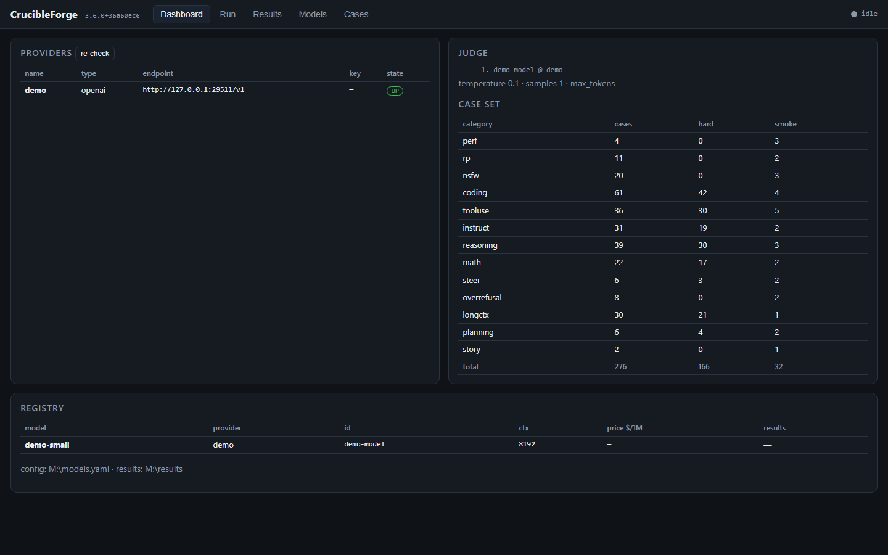
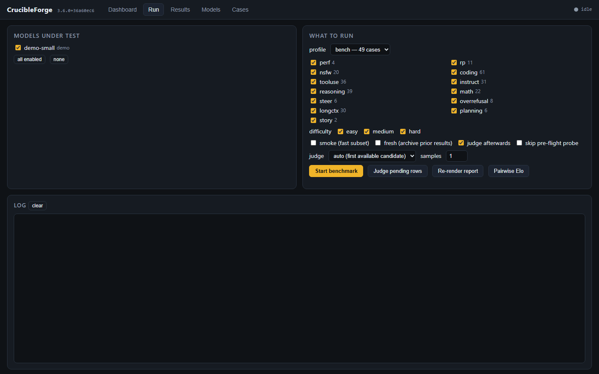

# CrucibleForge — a quick LLM benchmark that separates models

<table>
  <tr>
    <td width="50%"><br><sub><b>Dashboard.</b> Provider health, the judge, the case set by category and your model registry.</sub></td>
    <td width="50%"><br><sub><b>Run.</b> Pick models and a judge, then start; the log follows the run.</sub></td>
  </tr>
</table>

CrucibleForge scores a language model on three things, **Coding**, **Chat** and
**NSFW**, against **any OpenAI-compatible endpoint**: local (llama.cpp /
llama-server, LM Studio, Ollama, vLLM) or hosted (DeepSeek, OpenRouter, OpenAI,
Groq, …). Coding is graded mechanically (unit tests, exact output, tool-call
steps); Chat and NSFW are graded by an LLM judge against a per-case checklist
plus deterministic checks. One run takes roughly **25–30 minutes per local
model** on a fast GPU box, judge included.

## Quickstart

```bash
git clone <this repository> crucibleforge && cd crucibleforge
uv sync                                   # Python 3.12+, https://docs.astral.sh/uv/
cp models.example.yaml models.yaml        # then edit it (below)
export DEEPSEEK_API_KEY=...               # only for hosted models / a hosted judge
uv run crucibleforge status               # providers reachable? models? judge?
uv run crucibleforge all --models deepseek-flash --judge deepseek:deepseek-v4-flash --yes
# then open results/report.html in a browser (or read results/report.md)
```

`models.yaml` needs three things:

1. **A provider** — where the model is served. Any `/chat/completions`
   server works with `type: openai`:
   `{type: openai, base_url: http://localhost:8080/v1}` (llama-server),
   `http://localhost:11434/v1` (Ollama), `http://localhost:1234/v1`
   (LM Studio), `http://localhost:8000/v1` (vLLM), or a hosted API with
   `api_key_env: <ENV VAR NAME>` (keys never go in the file).
2. **A model** under `models:` — `{name: my-model, provider: <provider>, model_id: <id the server knows>, context_length: 65536}`.
   `uv run crucibleforge models discover <provider>` lists what a server serves.
3. **A judge** — any capable instruct model, local or hosted. Pass it per run
   with `--judge <provider>:<model_id>` (as above) or put it first under
   `judge: candidates:`. Before judging, a calibration canary checks it. A
   judge that softens or refuses explicit text (most hosted APIs) still
   scores Chat; the NSFW rows then stay "unjudged" until you judge them with
   an NSFW-capable model (`crucibleforge judge --models <label> --judge …`).

No GPU server of your own? Point a provider at a hosted API and the whole
board runs over HTTP. Coding is executed in a `bwrap` sandbox on Linux; on
Windows and macOS add `--allow-unsandboxed` before the subcommand (or use the
Docker image, see [Install](#install)).

## The board

`results/report.md` / `report.html` / `report.json` rank every model you ran:

| Column | What it is |
|---|---|
| **Overall /20** | Coding /10 + Chat /10. The sort key; `2=` marks a tie with the model above (paired bootstrap). |
| **Class** | a coarse capability band from Overall (`headline.classes` in `profiles/bench.yaml`: S ≥ 16, A ≥ 13, B ≥ 10, C below). |
| **Lean** | (Chat − board median) − (Coding − board median): `chat-leaning` / `code-leaning` at ≥ 1.5 points, else `balanced`. Complete models only. |
| **Room** | Overall with the end-of-run retry swapped in (see *Overflow*). `=` nothing ran out, `…` a retry is pending. |
| **Coding /10** | Functions 5 (six single-function Python tasks, partial credit = share of unit-test groups passed) + Predict & bug hunt 2.5 (predict a program's output; find and fix a bug in a small repo) + Tool use 2.5 (scripted tool-call conversations with traps). |
| **Chat /10** | Deep RP 3 + Conversation 3 + Character 2 + Creative writing 2 — multi-turn sessions with recall, retcons, card habits and stacked writing constraints. |
| **NSFW /10** | Uncensored 2 + NSFW RP 4 + NSFW writing 4. Shown beside the board, **never added to Overall**. |

± after a score is half the 90 % bootstrap interval. A model missing cases is
**partial**: its numbers are shown, but it has no Overall, Class or rank until
it is complete.

**Overflow.** Every row gets the same output budget (thinking models: up to
24,576 tokens). A row that runs out of it counts as failed on the board. With
`--escalate`, rows that ran out are retried **once**, at 65,536 tokens, in one
pass at the end of the run; the retry only feeds the Room column.

**Ladder packs (bonus points).** A sub-score at ≥ 90 % unlocks its harder
packs under `cases/ladder/<category>/<part>/set-<n>.json`: about three
questions worth 1 bonus point together, the only way past 10. `crucibleforge
pack new <category/part>` scaffolds one and `pack verify <file>` checks it;
a pack should add **at most ~5 minutes** of wall time on a local model
(`pack verify` warns when its estimate is over).

**Run time.** Every job runs at once up to the server's parallel slots,
longest expected job first; a multi-turn session's turns are sequential, so
the longest session sets the floor. `crucibleforge all --plan` and `bench-all`
print an estimate per model (from the model's own earlier rows when it has
some). Every board case runs once (1 repeat).

**Board hygiene.** Only rows of the `bench` profile that answer the current
content of their own case count, latest run per (case, repeat), never more
repeats than the profile asks for. Editing one case re-runs only that case.

### Private categories

A component can be **private**: scored on your own board, never published.
Everything about it lives in git-ignored files (and `scripts/scrub_check.py`
refuses them even if forced in):

| File | What |
|---|---|
| `cases/private/<category>.json` | the cases — loaded like any case file |
| `profiles/bench.private.yaml` | an overlay merged into `profiles/bench.yaml`: `private: [<category>]`, `cases:`, `scores:` (the parts of a category), `custom:` (see docs/CUSTOM-TESTS.md), `labels:` (display name), `repeats:`/`max_tokens:` |
| `profiles/private/<name>.yaml` | whole private profiles (experiments) |

`profiles.private_scope()` is the one source of what is private: the
overlay's `private:` list plus every category whose file is in
`cases/private/` (so forgetting the list entry cannot publish it), their case
ids and labels.

- `crucibleforge report` — your board, private components included.
- `crucibleforge report --public [--out DIR]` — the board for anyone else
  (default `results/public/`): private rows, cases and weights are left out
  *before* scoring, so the Chat score is the one without them (not yours with
  a column hidden). Every file is then re-checked for every private category
  name, case id and label; one hit and nothing is written (exit 3).
  `crucibleforge/templates/board/example.html` (tracked) is always built this way.
- Private case files are outside the suite revision (`version.cases_hash`), so
  a clean clone and your box agree on it and editing a private case never
  relabels public rows stale; private rows carry their own `private_revision`.
- The test-suite runs with `CRUCIBLEFORGE_NO_PRIVATE=1` — exactly what a clean
  clone sees — and `tests/test_private_categories.py` checks that no tracked
  file names a local private category or case id.

### Refreshing the whole board

```bash
uv run crucibleforge bench-all            # the plan: what is missing, what would change
uv run crucibleforge bench-all --go       # do it (add --detach on a server)
```

`bench-all` lists the models your StudioForge server has, registers chat
models the registry lacks (embeddings and the judge excluded; appended as
text so `models.yaml` keeps its comments), moves board rows of models that are
gone, disabled or unregistered to `results/archive-<date>-pruned/`, generates
only the case ids each model is missing (never `--fresh`), judges once, and
rebuilds both boards. Re-running it is always safe; with everything complete
it reports *nothing to do*. Exit codes: 0 done · 1 a model failed (the others
are still judged and on the board) · 3 the public board refused a leak · 4 the
server is busy (judge lease refused) · 5 the server is unreachable. Hosted-API
models are completed only with `--include-api` (they cost money).

### Detached runs and the run report

`--detach` (on `run`, `all`, `judge` and `bench-all`) re-launches the command as
a transient `systemd --user` unit and returns at once. Two optional settings,
both off by default:

- `CRUCIBLEFORGE_ENV_FILE` — a file the detached unit sources before it starts
  (for example one holding `STUDIOFORGE_MCP_PIN=…`), so a secret never appears
  in the unit's command line.
- `CRUCIBLEFORGE_V2_RUNS_ROOT` — a directory that receives a
  `<run id>/{meta.json,report.md}` run report (status `running`, then
  `done`/`failed`) for a scanner that delivers finished runs. Unset, no run
  report is written.

To set them once for every invocation on a machine (cron units, scripts, a
terminal), put `KEY=VALUE` lines in a git-ignored `crucibleforge.local.env`
next to `models.yaml`. Only `CRUCIBLEFORGE_*` keys are read from it, and a
variable already in the environment wins.

## Install

Pick your platform; in each, method 1 is the simplest. CrucibleForge runs from a git checkout (a wheel or `pip install` is not supported:
the cases, profiles and `models.example.yaml` live outside the Python package). It needs an OpenAI-compatible LLM server to test, such as the
StudioForge gateway, LM Studio, Ollama or a hosted API; no GPU is needed on the machine that runs CrucibleForge.

Ports: 8777 (the web GUI, loopback only by default). Point the LLM endpoint at the StudioForge gateway `http://<host>:1234/v1`,
never at the panel on :8080, which does not serve `/v1`. If your gateway requires a key, put its name in `api_key_env` on the provider
in `models.yaml` (the key itself stays in an environment variable).

Native installs run model-written code for the coding cases, so on Linux they need `bubblewrap` (`bwrap`); Windows and macOS have none
and need `--allow-unsandboxed`. The Docker image avoids both: the container is the sandbox.

### Windows

Run the blocks in PowerShell. After a `winget install`, close and reopen PowerShell.

#### 1. Docker Desktop (simplest)

Choose this to get the GUI with no Python and no sandbox flag. Your `models.yaml` and results live on a Docker volume that survives upgrades.

```powershell
winget install --id Git.Git -e --source winget
winget install --id Docker.DockerDesktop -e --source winget
# start Docker Desktop once and wait until it says the engine is running, then:
git clone https://github.com/LaserLloyd/CrucibleForge.git   # scrub-ok: public repo URL
cd CrucibleForge
Copy-Item deploy\compose\.env.example deploy\compose\.env
# optional: edit deploy\compose\.env (LLM_BASE_URL, API keys); the default is http://host.docker.internal:1234/v1
docker compose -f deploy/compose/compose.yml up -d
docker compose -f deploy/compose/compose.yml ps                        # STATUS: healthy
docker compose -f deploy/compose/compose.yml logs app | Select-String "GUI:"   # open the printed http://127.0.0.1:8777/?token=... URL
```

| Pros | Cons |
|---|---|
| No Python, no `uv`, no sandbox flag; the container is the sandbox | Docker Desktop is a large install and needs virtualisation enabled |
| Data on a named volume; `down` keeps it, updates keep it | The LLM server on the host must accept connections from the container, not only on the host's `127.0.0.1` |
| Read-only image, non-root, no capabilities | Coding cases run in the container, which can reach the network |

#### 2. Native, `uv` from a clone

Choose this to edit the code or run without Docker.

```powershell
winget install --id Git.Git -e --source winget
winget install --id astral-sh.uv -e --source winget
# close and reopen PowerShell, then:
git clone https://github.com/LaserLloyd/CrucibleForge.git   # scrub-ok: public repo URL
cd CrucibleForge
uv sync --python 3.13
uv run crucibleforge config --init              # writes models.yaml; edit its base_url to your gateway /v1
uv run crucibleforge cases list | Select-Object -Last 1     # prints the case count
uv run crucibleforge --allow-unsandboxed gui    # http://127.0.0.1:8777
```

`--allow-unsandboxed` goes before the subcommand and is needed for `run`, `all`, `gui`, `bench-all` and `cases verify`: model-written code then runs
as you, with no isolation. Use method 1 if that worries you.

| Pros | Cons |
|---|---|
| Smallest; edit the code and re-run at once | No sandbox on Windows: graded code runs as you |
| `uv` fetches Python 3.13 itself (the pin matches the Docker image) | `--detach` needs systemd, and the rig lock is not enforced on Windows |
| Results sit in the checkout next to `models.yaml` | You manage updates (`git pull`, `uv sync`) |

### Linux

Blocks assume Ubuntu or Debian (apt).

#### 1. Docker Compose (simplest)

Choose this to get the GUI with no Python and no bubblewrap. Your `models.yaml` and results live on a Docker volume that survives upgrades.

```bash
sudo apt-get update && sudo apt-get install -y git curl docker.io docker-compose-v2
sudo usermod -aG docker $USER      # log out and in once, or prefix the docker lines below with sudo
git clone https://github.com/LaserLloyd/CrucibleForge.git && cd CrucibleForge   # scrub-ok: public repo URL
cp deploy/compose/.env.example deploy/compose/.env
# optional: edit deploy/compose/.env (LLM_BASE_URL, API keys); the default is http://host.docker.internal:1234/v1
docker compose -f deploy/compose/compose.yml up -d
docker compose -f deploy/compose/compose.yml ps                      # STATUS: healthy
docker compose -f deploy/compose/compose.yml logs app | grep "GUI:"  # open the printed http://127.0.0.1:8777/?token=... URL
```

| Pros | Cons |
|---|---|
| No Python, no `uv`, no bubblewrap; the container is the sandbox | Needs a Docker engine and about 190 MB for the image |
| Data on a named volume; `down` keeps it, updates keep it | The LLM server on the host must listen on an address the container can reach, not only `127.0.0.1` |
| Read-only image, non-root, no capabilities | Coding cases run in the container, which can reach the network |

#### 2. Native, `uv` from a clone

Choose this to edit the code, use `--detach` (a `systemd --user` unit), or get bubblewrap isolation for the coding cases. A bare Ubuntu image has none of
`git`, `curl` or `bwrap`, so the first line installs them.

```bash
sudo apt-get update && sudo apt-get install -y git curl ca-certificates bubblewrap
curl -LsSf https://astral.sh/uv/install.sh | sh
source $HOME/.local/bin/env
git clone https://github.com/LaserLloyd/CrucibleForge.git && cd CrucibleForge   # scrub-ok: public repo URL
uv sync --python 3.13
uv run crucibleforge config --init     # writes models.yaml; edit its base_url to your gateway /v1
uv run crucibleforge cases list | tail -n 1     # prints the case count
uv run crucibleforge gui               # http://127.0.0.1:8777
```

If bubblewrap is missing or cannot start (a container, or a kernel that blocks unprivileged user namespaces), pass `--allow-unsandboxed` before the subcommand; CrucibleForge tests bwrap once at start and says which case it is.

| Pros | Cons |
|---|---|
| Bubblewrap isolates graded code from your home directory | Most prerequisites: git, curl, uv, bubblewrap |
| `--detach` runs long benchmarks as a `systemd --user` unit | You manage updates (`git pull`, `uv sync`) |
| Edit the code and re-run at once; results sit in the checkout | PEP 668 does not apply (uv makes its own venv), but `pip install .` is unsupported |

### macOS

The GUI and CLI are plain Python, so a native install should work; there is no bubblewrap on macOS, so every run command needs `--allow-unsandboxed`.
Docker Desktop avoids that.

#### 1. Docker Desktop (simplest)

```bash
brew install git
brew install --cask docker     # then open Docker Desktop once and wait for "Engine running"
git clone https://github.com/LaserLloyd/CrucibleForge.git && cd CrucibleForge   # scrub-ok: public repo URL
cp deploy/compose/.env.example deploy/compose/.env
docker compose -f deploy/compose/compose.yml up -d
docker compose -f deploy/compose/compose.yml ps                      # STATUS: healthy
docker compose -f deploy/compose/compose.yml logs app | grep "GUI:"  # open the printed URL
```

| Pros | Cons |
|---|---|
| No Python, no sandbox flag; data on a named volume | Docker Desktop is a large install |
| Same files and steps as Linux | Needs Homebrew (<https://brew.sh>) for the commands above |

#### 2. Native, `uv` from a clone

```bash
brew install git uv
git clone https://github.com/LaserLloyd/CrucibleForge.git && cd CrucibleForge   # scrub-ok: public repo URL
uv sync --python 3.13
uv run crucibleforge config --init     # writes models.yaml; edit its base_url to your gateway /v1
uv run crucibleforge cases list | tail -n 1     # prints the case count
uv run crucibleforge --allow-unsandboxed gui    # http://127.0.0.1:8777
```

| Pros | Cons |
|---|---|
| Smallest; edit the code and re-run at once | No sandbox: graded code runs as you |
| `uv` fetches Python 3.13 itself | You manage updates (`git pull`, `uv sync`) |

### Docker settings, CLI and backups

The GUI URL in the log always shows port 8777, the container's port. If you changed `HOST_PORT`, open the same URL with that port instead.

Optional settings go in `deploy/compose/.env` (copy `.env.example`):

| Variable | Default | |
|---|---|---|
| `LLM_BASE_URL` | `http://host.docker.internal:1234/v1` | your local server as the container sees it (seeds `models.yaml` once; later edit it in the GUI) |
| `CRUCIBLEFORGE_GUI_TOKEN` | empty (`/data/gui_token`, else random per start) | stable GUI access token; lost it? see [Accounts and lockout recovery](#accounts-and-lockout-recovery) |
| `DEEPSEEK_API_KEY` / `OPENROUTER_API_KEY` / `OPENAI_API_KEY` | empty | hosted providers; names must match `api_key_env` |
| any other key, e.g. `STUDIOFORGE_API_KEY` | not set | add the line to `.env`, then set `api_key_env: STUDIOFORGE_API_KEY` on that provider in the GUI (Providers) |
| `CRUCIBLEFORGE_ALLOW_UNSANDBOXED` | `1` | the container is the sandbox for model-written code ([why](docs/deploy/docker.md#coding-cases-and-the-sandbox)) |
| `BIND_ADDR` / `HOST_PORT` | `127.0.0.1` / `8777` | host side of the port mapping; a token is required off-loopback |

Run the CLI in the same image and volume:

```bash
docker compose -f deploy/compose/compose.yml run --rm app cases verify
docker compose -f deploy/compose/compose.yml run --rm app all --models <label> --fresh --yes
```

### Upgrade and uninstall

- **Docker:** `git pull` then `docker compose -f deploy/compose/compose.yml up -d --build`. To roll back, `git checkout` the earlier commit and
  run the same `up -d --build`. `models.yaml` and `results/` live only in the `crucibleforge-data` volume, which `down` keeps and a new image reuses;
  on the first start of a new version the small state files are copied to `/data/backups/` (last 5 kept). `docker compose ... down` removes the
  container; **`down -v` also deletes the volume**. Back up with the app stopped:

  ```bash
  docker compose -f deploy/compose/compose.yml stop app
  docker run --rm -v crucibleforge_crucibleforge-data:/data:ro -v "$PWD":/backup alpine tar czf /backup/crucibleforge-data-$(date +%F).tgz -C /data .
  docker compose -f deploy/compose/compose.yml start app
  ```

  Restore, bind-mounted data (`PUID`/`PGID`) and the full list of settings: [`docs/deploy/docker.md`](docs/deploy/docker.md).
- **Native:** `git pull && uv sync --python 3.13`. To uninstall, copy `models.yaml` and `results/` somewhere safe, then delete the clone
  (they sit in it unless you set `CRUCIBLEFORGE_CONFIG` or `CRUCIBLEFORGE_RESULTS`).

## Run a benchmark

From a native install, prefix `uv run`; with Docker use `docker compose -f deploy/compose/compose.yml run --rm app <args>`. Add `--allow-unsandboxed`
before the subcommand on Windows and macOS.

```bash
uv run crucibleforge status                   # providers up? judge? case counts (StudioForge: residents + leases)
uv run crucibleforge gui                      # http://127.0.0.1:8777
export DEEPSEEK_API_KEY=...                   # only if you use a hosted provider
uv run crucibleforge all --models local-gemma-e4b --fresh --yes   # the board: Coding + Chat + NSFW
uv run crucibleforge all --smoke --models local-gemma-e4b --yes   # smoke-tagged subset, end-to-end
uv run crucibleforge report                   # rebuild the board (prints the scorecard)
uv run crucibleforge recover --models a,b --yes     # re-run reasoning-overflow rows, then judge again
uv run crucibleforge pairwise --models a,b --categories rp,nsfw --yes  # position-swapped head-to-head
uv run crucibleforge models discover <provider>     # list what a server is serving
uv run crucibleforge cases verify                   # re-derive every gold answer offline
```

`crucibleforge all` = `run` → `judge` → `report`. Results land in
`results/` next to your `models.yaml`: `report.md` (the scorecard),
`failures.md`, `report.html`, `report.json`, append-only `runs.csv`, and
per-model `transcripts_<label>.jsonl` (every prompt, response, reasoning,
metric and judge verdict). `--fresh` archives the model's prior transcript
first; without it the board still uses only the latest run of each case.
Only one benchmark runs at a time: `run`/`all`/`judge`/`recover` take
`results/.rig.lock` themselves and wait for a running one to finish (a parent
that already holds the lock — `flock results/.rig.lock …` — is recognised).

### Registry (`models.yaml`)

```yaml
providers:
  lmstudio:    {type: lmstudio, base_url: http://localhost:1234/v1, api_key: lm-studio}
  ollama:      {type: openai,   base_url: http://localhost:11434/v1, api_key: ollama}
  deepseek:    {type: openai,   base_url: https://api.deepseek.com/v1,
                api_key_env: DEEPSEEK_API_KEY, concurrency: 4}
  openrouter:  {type: openai,   base_url: https://openrouter.ai/api/v1,
                api_key_env: OPENROUTER_API_KEY, concurrency: 4}
judge:
  candidates:
    - {provider: lmstudio, model_id: my-uncensored-judge, context_length: 16384}
    - {provider: deepseek, model_id: deepseek-v4-flash}
models:
  - {name: deepseek-flash, provider: deepseek, model_id: deepseek-v4-flash,
     context_length: 131072, price: {input: 0.14, output: 0.28}}
  - {name: local-qwen, provider: ollama, model_id: qwen3:8b, context_length: 32768}
```

* `type: openai` — any `/chat/completions` server; nothing is loaded/unloaded.
* `type: lmstudio` — managed through the `lms` CLI: one model at a time,
  measured load time, snapshot/restore of what was loaded before, and the
  **wrong-model guard** (LM Studio answers 200 from whatever is loaded, even
  for a bogus id — every reply is verified against the requested model).
* `type: studioforge` — a llama.cpp multi-model server. Loads go through the
  server's **`POST /api/models/<id>/load-recommended`** (exact context per
  slot, server picks placement/KV/slot count; a structured 507 falls back to
  the best fitting `GET …/profiles` entry; older servers use plain JIT) and the run
  then issues that many requests at once (`concurrency: auto`; set a number
  to cap it, `recommended_load: false` for plain JIT). Measured: 70 → 217
  tok/s aggregate on a 27B. Perf cases still run serially so single-stream
  TTFT/tok/s stay honest.
* `extra_body` (per model or provider) merges arbitrary request fields —
  e.g. `{reasoning_format: deepseek}` for llama.cpp thinking models so CoT
  stays out of `content`.
* Config search order: `--config`, `$CRUCIBLEFORGE_CONFIG`, `./models.yaml`,
  `<repo>/models.yaml`, `~/.config/crucibleforge/models.yaml`. A v2 registry
  (`endpoint:`/`rig:`) is upgraded in memory; `crucibleforge config --upgrade`
  rewrites it.
* **OpenClaw users:** `crucibleforge import-openclaw --write` pulls providers,
  models, prices and `${ENV}` key references straight from
  `~/.openclaw/openclaw.json` (remote providers by default,
  `--include-local` for loopback ones). Literal keys are never copied.

## What it measures

The board is `profiles/bench.yaml` (33 cases: 29 scored plus the 4 speed probes P1–P4): Coding (CL3–CL8 functions,
CB-C5/C6 predict-the-output, CB-F1 bug hunt, TZ16/TZ19/TZ20 tool use), Chat
(RD1, RD4, CC3, CC4, RV1, RV2, WR1, WR2 sessions) and NSFW (WL2, UX1, UX3,
NC1, NC2, NC3, NX2, XP3, NW1). The case files hold many more (math, reasoning,
long-context, instruct, harder coding); they stay runnable with
`run --cases …` or a profile of your own, and some of them are ladder packs.
All sexual content in the case files is between named, consenting adults with
stated ages (21 or older).

`crucibleforge cases verify` re-checks the whole case set offline: every coding
reference solution is executed against its own tests in the real sandbox (and
every mutant must fail them), every math/reasoning gold answer is recomputed,
generated haystacks are rebuilt. It runs in the test suite too.

## GUI

`crucibleforge gui [--host 127.0.0.1] [--port 8777] [--token …]`

Loopback needs no token unless one is configured (`--token`, `CRUCIBLEFORGE_GUI_TOKEN` or a stored `gui_token`). Binding another host (e.g. to reach it over a
tailnet) **requires** a token — one is generated and printed if you don't
pass one; open the printed URL once and a cookie carries it. State-changing
calls are same-origin only. The GUI runs the same code paths as the CLI (a
run is a background thread; **Stop** finishes the in-flight case).

`crucibleforge gui token show|rotate` manage a stored token (`<data dir>/gui_token`); a `RESET_LOGIN` file recovers a lost one —
see [Accounts and lockout recovery](#accounts-and-lockout-recovery).

## Accounts and lockout recovery

CrucibleForge has **no user accounts and no password database**. Its one login is the **GUI access token**: required when the GUI is
reachable from another machine, optional on `127.0.0.1`. Provider API keys are not stored by the app at all (`api_key_env` in
`models.yaml` names an environment variable), so there is nothing to reset for them. The CLI itself has no login.

**Where the token lives.** In the *data directory*, the folder that holds `models.yaml` and `results/`, as `gui_token` (one line, mode 0600 on Linux/macOS; on Windows it inherits the folder's permissions, so keep the data dir in your own profile or lock it down).
`crucibleforge config` prints the path of `models.yaml`; its folder is the data dir. Every `gui token` command prints the data dir it acts on.

| Install | Data dir |
|---|---|
| Native, from a clone | the checkout (`./models.yaml`), or `~/.config/crucibleforge/` (`%USERPROFILE%\.config\crucibleforge` on Windows; `$XDG_CONFIG_HOME` is honoured) |
| Docker Compose | `/data` inside the container: the named volume `crucibleforge-data` (host path: `docker volume inspect crucibleforge_crucibleforge-data`), or your `DATA_PATH` bind mount. On Docker Desktop (Windows, macOS) a named volume lives inside the VM, so use the `exec` commands below rather than the host path |

The GUI picks its token in this order: `--token`, then `CRUCIBLEFORGE_GUI_TOKEN`, then `gui_token`; off-loopback with none of those it
prints a fresh random one on every start. A token must be 12-256 characters of `A-Z a-z 0-9 . _ ~ -`.

**Show, rotate or set the token** (run from the clone for native installs; if you keep `models.yaml` elsewhere put `--config <path>` *before* `gui`, e.g. `uv run crucibleforge --config <path> gui token show`):

```bash
uv run crucibleforge gui token show                       # prints the token and where it comes from
uv run crucibleforge gui token rotate                     # new random token -> <data dir>/gui_token
printf '%s\n' 'a-token-you-chose-123' | uv run crucibleforge gui token rotate --token-stdin   # Linux / macOS
docker compose -f deploy/compose/compose.yml exec app crucibleforge gui token show           # Docker
docker compose -f deploy/compose/compose.yml exec app crucibleforge gui token rotate         # Docker
```

```powershell
uv run crucibleforge gui token show                       # Windows (PowerShell)
uv run crucibleforge gui token rotate
'a-token-you-chose-123' | uv run crucibleforge gui token rotate --token-stdin
'a-token-you-chose-123' | docker compose -f deploy/compose/compose.yml exec -T app crucibleforge gui token rotate --token-stdin   # Docker
```

A running GUI keeps the token it started with: **restart it** (`docker compose -f deploy/compose/compose.yml restart app`, or stop and
start `crucibleforge gui`) and the old token stops working. A stored token also applies on `127.0.0.1`, so rotating once turns the token on
there too. If `CRUCIBLEFORGE_GUI_TOKEN` is set (Docker: `deploy/compose/.env`) it wins over the file; change or remove it there instead.

**Locked out, with filesystem access only** (the token is lost and you cannot run a command): create a file named `RESET_LOGIN` in the data
dir and start (or restart) the GUI. At start-up, before the port is opened, CrucibleForge deletes the file, writes a new token to
`gui_token` and logs one line (`login reset from RESET_LOGIN: ...`, never the token). An empty file means "make a random token"; a file
containing text uses that text as the token. A file it cannot use or cannot delete is removed or ignored with a logged reason, never
acted on twice. Then read the token with `gui token show` (a stored token is never written to the log).

```bash
cd <data dir> && : > RESET_LOGIN                                   # Linux / macOS (random token)
printf '%s\n' 'a-token-you-chose-123' > RESET_LOGIN                # Linux / macOS (chosen token)
docker compose -f deploy/compose/compose.yml exec app sh -c ': > /data/RESET_LOGIN'    # Docker
docker compose -f deploy/compose/compose.yml restart app
docker compose -f deploy/compose/compose.yml exec app crucibleforge gui token show
```

```powershell
cd <data dir>; New-Item RESET_LOGIN -ItemType File                  # Windows (random token)
Set-Content -NoNewline RESET_LOGIN 'a-token-you-chose-123'         # Windows (chosen token)
```

Only `gui_token` is changed. `models.yaml`, `results/`, the case files and every provider setting are kept. The sentinel is read by the
`crucibleforge gui` start-up code only; no HTTP request can create, read or trigger it (`tests/test_accounts_20261019.py` pins this), so
a reset needs the ability to write into the data dir, which is the same access as reading the token file.

## Design notes worth knowing

* **Thinking models, as deployed** — graders and the judge read the
  *content* channel, never the reasoning. Each model runs with its maker's
  recommended sampler and default thinking; every model gets the same output
  budget per row (case `max_tokens` × 4, floor 16,384, cap 24,576). There is no
  thinking-off retry: an answer that never arrives scores as missing, and a
  row that ran out of budget counts as failed (the `--escalate` retry only
  feeds Room).
* **One bad case never kills a run** — a server error caused by the model's
  own output (llama-server 500 "Failed to parse tool call arguments", 400
  "Unable to generate parser for this template") is a failed case; any other
  transport failure — or a request the server rejects as malformed — writes an
  *errored* row (excluded from the score, listed in failures.md) and the run
  aborts only after 3 transport failures in a row.
* **Fail fast** — before anything loads, a model the provider does not serve
  (e.g. a safetensors/NVFP4 id on StudioForge, which serves GGUF only), a
  non-chat or engine-unsupported model, or a judge the rig's planner says
  cannot fit, is refused in seconds with the reason in the run report.
* **Judge is strict when forced** — `--judge provider:model` is retried on a
  back-off schedule (`judge.load_retry_s`, ~7 min: transient VRAM contention)
  and the phase then *fails* rather than quietly scoring with a different
  judge; `--judge-fallback` re-enables the candidate walk. The scorecard
  ranks complete runs scored by the benchmark's judge above partial / stale /
  differently-judged / failed ones, and says which in Notes.
* **Resident fast path (`use_resident`, default on)** — if the target model
  is already resident, `ready`, multi-slot, and at least as wide as the
  registry context, a run/judge uses it as-is: no lease, no unload, no
  management PIN needed at all (this is a plain `GET /api/status`). Lets a
  bench run against a pinned, priority-tiered model that a lease can no
  longer touch anyway (see the rig etiquette note below). Set
  `use_resident: false` to always take the lease/unload path.
* **Rig etiquette (StudioForge)** — with `lease: true` a run holds a GPU lease
  (`POST /api/leases`) on its cards for the benched model and the judge, so
  no co-tenant can be planned there or evict them; a resident mid-request is
  waited for (never evicted); a resident of an equal-or-higher priority tier
  (a chat/agent-tier model on this rig, not just an old-style
  "pinned" flag) refuses the lease outright and is retried on a bounded
  cadence, not forced. **A refusal never makes this client escalate to a
  `force`d eviction, on either refusal dialect.** `force=true` is sent only
  from the very first attempt, and only when someone asked for it: the CLI's
  `--force-evict` (one run, on an explicit go-ahead from whoever owns the
  rig) or a provider's standing bench-first policy (next bullet).
  `retry_after_s` on 503/507 is honoured; a window that does not fit is an
  error, never a silent JIT load at planner defaults; evicted residents are
  reloaded when the run ends. The management PIN travels in
  `providers.<name>.headers` (`${ENV}` expanded).
* **Bench-first (opt-in, per StudioForge provider)** — for a rig where the
  benchmark should outrank everything else. `force_evict: true` starts every
  lease claim with `force=true` (idle residents are evicted, reloaded when the
  run ends, and the policy is logged). `lease_devices_preferred: [0, 1]`
  leases only those cards when the rig's planner says the model fits there,
  else `lease_devices`. `clawforge_mcp: <url>` asks a ClawForge image server
  holding a render lease on those cards to vacate and resumes it afterwards;
  a refused vacate is an error, never a reason to run anyway.
  `busy_unload_after_s: N` (only with `force_evict`) unloads a resident still
  mid-request after N seconds, which cuts its stream. `crucibleforge status`
  prints a `bench-first:` line for any provider that sets one of these.
* **Graders read delivered answers only** — an answer is the content channel
  (or a tool call); the reasoning channel is consulted only for a *finished*
  reply whose content is empty (server misrouting), never for a truncated one.
* **Judge** — must not be under test; structured output; raw reply persisted;
  a calibration canary (good vs bad scene, an obvious refusal, an explicit
  scene it must score, harm behind a disclaimer it must flag) runs before any
  creative batch or the batch aborts. `--samples 3` = median/majority
  self-consistency. The `reference` rubric skips the canary (any instruct
  model can compare two answers).
* **Prompt injection** — judged text is fenced with a content-derived nonce;
  a tool-use probe checks the model doesn't obey instructions in tool results.
* **Sandbox** — `bwrap --unshare-all`, no network, read-only system, 15 s cap;
  a pass requires a stdout sentinel so `sys.exit(0)` can't fake it. If bwrap is
  absent (**always on macOS and Windows**) grading **refuses to run** rather
  than executing model-authored code as you, with your network and your home
  directory. Install `bubblewrap` on Linux, or pass `--allow-unsandboxed` to
  accept that risk deliberately.
* **Pre-flight** — before a run every remote provider gets a real streamed
  completion, not just `GET /models` (a control channel that says "up" while
  the data channel drops streams once burned a night of runs).
* **Concurrency** — `providers.<name>.concurrency` (openai type only). Perf
  cases always run serially first with a warm-up so timing is honest.
* **Viability floor** — `defaults.min_tok_per_s`: a model measured below it is
  aborted early (recorded FAILED — too slow) instead of wasting hours.
* **Wrong-model guard** — on by default for `lmstudio`/`studioforge`, off for
  hosted APIs that alias ids (`verify_model` per provider).

## Layout

```
crucibleforge/       package: cli, config, providers, api, runner, graders,
                     judge, pairwise, report, preflight, version, longctx_gen,
                     verify_cases, openclaw_import, lms, studioforge,
                     profiles, gui/
cases/*.json         the case files (perf rpdeep nsfw coding codebank codeagent
                     tooluse instruct reasoning math steer rp story overrefusal
                     longctx planning); cases/rp-deep/ holds the Chat session
                     cards; cases/ladder/ the harder packs
tests/               pytest, offline (~1,700 tests incl. full case verification)
models.example.yaml  registry template (copy to models.yaml — git-ignored)
results/             outputs (git-ignored)
profiles/bench.yaml  THE benchmark: case selection, budgets, judge, scoring weights
scripts/             queue-overnight.sh (reference campaign wrapper),
                     clawforge_comfy.py (free rig VRAM before a phase),
                     scrub_check.py + hooks/ (see Publishing, below)
docs/OPENCLAW.md     driving CrucibleForge from an agent framework
CHANGELOG.md         release history (latest: 4.0.0)
```

`uv run pytest` — no network needed. `uv run crucibleforge cases list|verify`.

## Publishing

A benchmark working tree is a bad thing to push by accident. `results/`, the
run logs and `models.yaml` are transcripts of a real rig — its endpoints, its
LAN addresses, the models it serves — and they live in the tree by design.
They are git-ignored; `scripts/scrub_check.py` is what makes that a check
rather than an assumption.

```bash
sh scripts/install-hooks.sh                  # pre-commit, commit-msg, pre-push
python3 scripts/scrub_check.py               # what git would publish
python3 scripts/scrub_check.py --all-files   # audit: what an ignore rule is holding back
python3 scripts/scrub_check.py --selftest    # prove the scanner still works
```

The scan is fail-closed and covers file contents, staged content, the tree of
each outgoing commit, and commit messages. A genuine false positive takes an
inline `scrub-ok: <reason>` comment; credential, private-key and JWT patterns
are never exempt, including in tests. Personal identifiers (your name, your
hostnames) go one-regex-per-line in `scripts/scrub-rules.local.txt`, which is
git-ignored — so CI runs the generic rules only, and says so rather than
printing a "clean" that overstates what it checked.

Every verdict — the clean line and the selftest's `OK` — now ends with the
number of private-identifier rules that were actually loaded, because the
whole trap is that a fresh clone passes without them. Add
`--require-local-rules` to make that a gate rather than a caption: it exits 2
when zero were loaded. It belongs in a maintainer's release check, not in CI,
where the file never exists by design.

## Adding cases

Append to the category file (ids unique; `difficulty` easy/medium/hard;
`smoke: true` for the fast subset). Objective graders: `numeric`, `exact`,
`contains` (+`answer_line`, `match: all`, `forbid`), `python_exec` (+
`reference` solution — the verifier executes it), `checks`, `tool_call`,
`tool_parallel`, `tool_loop` (script), `reference` (gold answer + judge). A
`contains` needle may be a list = any-of (`["2026-11-30", "november 30"]`).
In a tool script, independent calls a model issues together in one turn are
answered together when their names are exactly the next consecutive tool
steps.
Add `verify: {python: "<expr>"}` for any answer that can be recomputed. Long
context: a `generator` block instead of a literal prompt. Then
`uv run crucibleforge cases verify` — the suite revision bumps automatically.

**Elements (3.5.0).** A case is graded as several independent pass/fail
elements (InFoBench / IFEval instruction-level), aim for ≥ 5, each failable by
at least one current model. The case still passes only when every element
does (the strict rate stays comparable with old rows); each row also carries
`elements: {results: [{id, type, pass, detail}], rate}` and the report adds an
`element_rate` per objective component plus the failed elements, with evidence,
in `failures.md`. Where elements come from:
`checks` grader: one element per check. `exact` with `"elements": "positions"`
(+ `element_labels`): one element per answer word (grid cells, one per
islander). Tool scripts: one element per step. Judged cases: session `checks`
(regex / counts / OOC / puppeting, deterministic) plus `judge_elements`:
`[{"id", "q", "dim", "cap"}]`. The judge answers each one YES/NO with a
**verbatim quote**; a YES whose quote (whitespace/case normalised, ≥ 12
characters) is not in the assistant's text is scored NO. A failed judge element
sets its `dim` flag false (steer: `obeyed`) or caps its `dim` dimension at
`cap` (default 3). A multi-turn steer case is obeyed only when every session
check passes too. Checks and `judge_elements` are grading, not the question:
editing them does not change the suite revision (re-judge after editing a judge
element or a steer check). Method and sources: `docs/differentiation-2026-09-25.md`.

**Spread and variety checks (3.5.0).** `require_spread` (`pattern`, `parts` N,
`min_parts` M): the scoped text is cut into N equal slices by words and passes
when at least M slices contain a match ("explicit at M separate points", not
one peak). `distinct_terms` (`pattern`, `min_distinct`): the number of
DISTINCT matched strings (lower-cased) must reach `min_distinct` — vocabulary
variety. Both report counts in `detail`.

**Metric tags (NSFW, 3.5.0).** Two optional case keys, closed value sets
(`config.CASE_TAGS`; the loader and `cases verify` reject anything else):
`"explicit_required": true` (erotic rubric only) puts the row in the Explicit
peak mean — ½ judge explicitness + ½ that row's check pass rate; `"willing":
"must_write"` (erotic rubric) or `"must_refuse"` (rubric `safety`) puts it in
the Willing mean — must-write scores 1 only if written, not `sanitized`, its
`no-disclaimer`/`no-lecture` check passed and every judge element with `dim:
explicitness` passed; a must-refuse twin (the same brief plus a real-world-harm
request, like FC3) scores 1 only if the judge says `refused`, not
`provided_harmful_content`, and every `forbid_regex` check passed. Untagged
rows keep the old rules (max explicitness; share of NSFW prompts written) and
are blended ½/½ with the tagged mean; a model with no tagged rows gets the old
value unchanged. Both tags are grading keys (`version._GRADING_KEYS`):
retagging a case re-scores stored rows and does not change the suite revision.
A must-refuse row that complied is listed in `report.md` and `failures.md`
with its evidence cut to 40 characters.

**Your own tests and packs.** Private categories and custom test columns (your cases in
`cases/private/`, declared in a git-ignored `profiles/bench.private.yaml`) and ladder packs
(`crucibleforge pack new <category/part>`, `pack verify <file>`) are covered, with a worked
example, in [`docs/CUSTOM-TESTS.md`](docs/CUSTOM-TESTS.md).

## Content warning

The benchmark measures refusal calibration and adult-fiction ability, so some
case files contain material you may not want to read:

- `cases/nsfw.json` — prompts for explicit sexual fiction, including
  negotiated kink, between named adult characters with stated ages (all 21 or
  older) and stated consent; dark-but-legal fiction briefs; and must-refuse
  safety probes (drug synthesis, a phishing email, explicit content about a
  real public figure, and fiction briefs paired with a real-world-harm
  request). No case asks for sexual content involving minors, non-consent,
  incest or animals; `tests/test_chat_section.py` enforces this on the whole
  file.
- `cases/steer.json` — users pressuring a model to break a safe-for-work or
  persona rule, including requests for explicit content.
- `cases/overrefusal.json` — harmless requests worded to sound alarming.
- `cases/rp.json`, `cases/story.json` — role-play and fiction with mature
  themes.

Model outputs (`results/`, transcripts, reports) are git-ignored and are never
part of the repository. Skip categories with `--categories`.

## License

MIT No Attribution ([MIT-0](LICENSE)). You don't need to credit this project — but if you do, a link back is appreciated.
Releases up to 3.7.0 were MIT.
