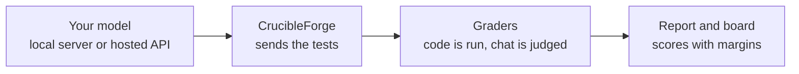
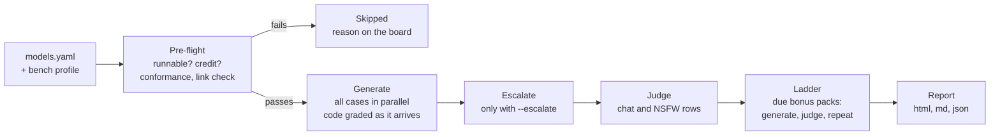
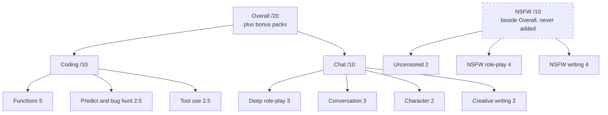
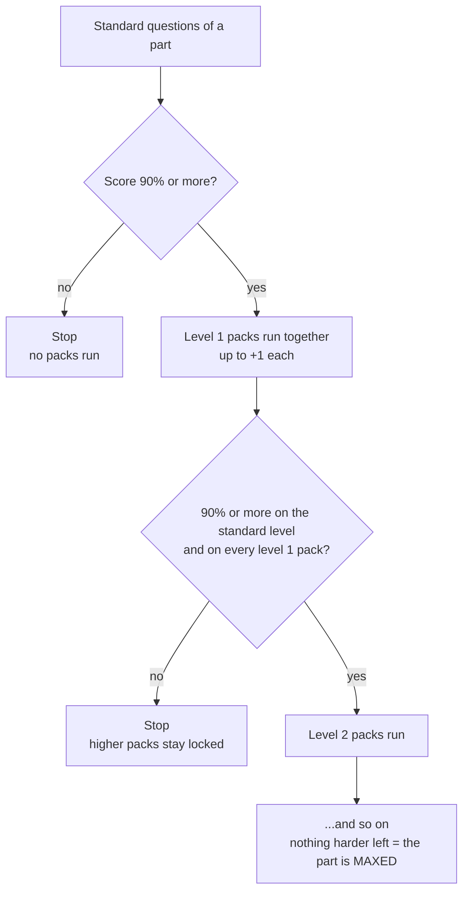
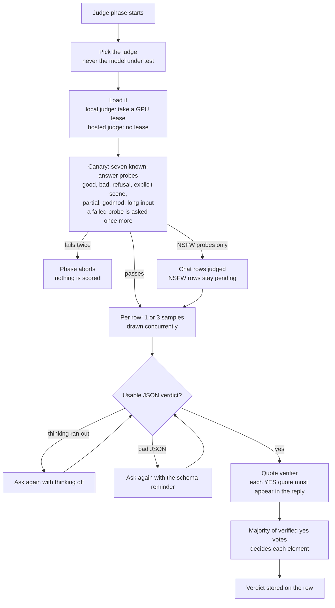
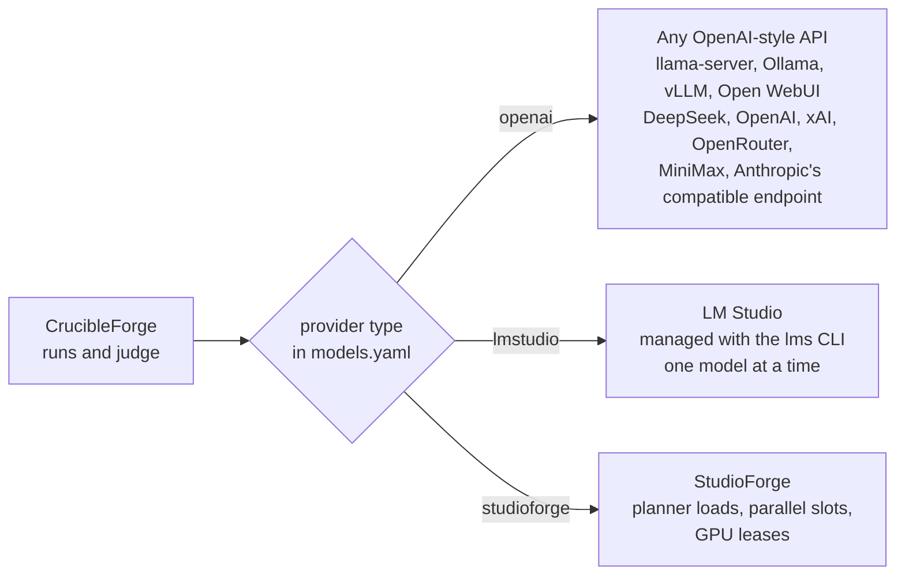
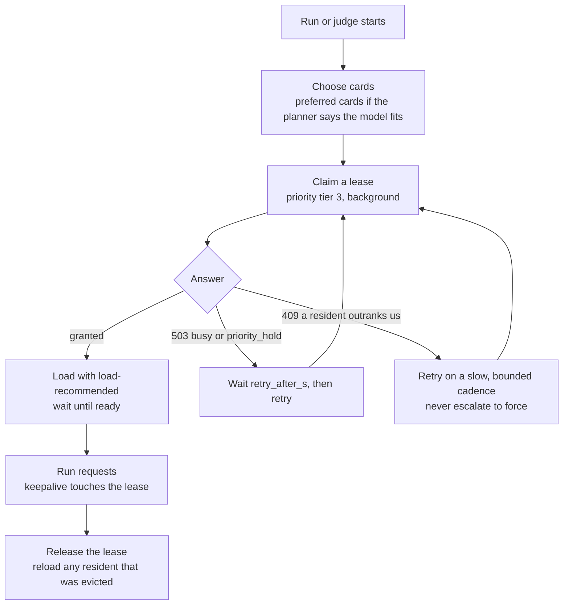
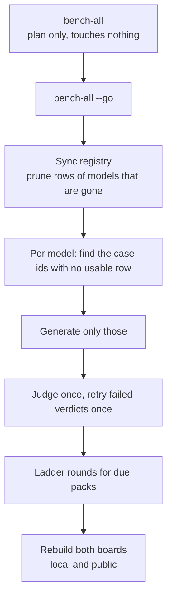
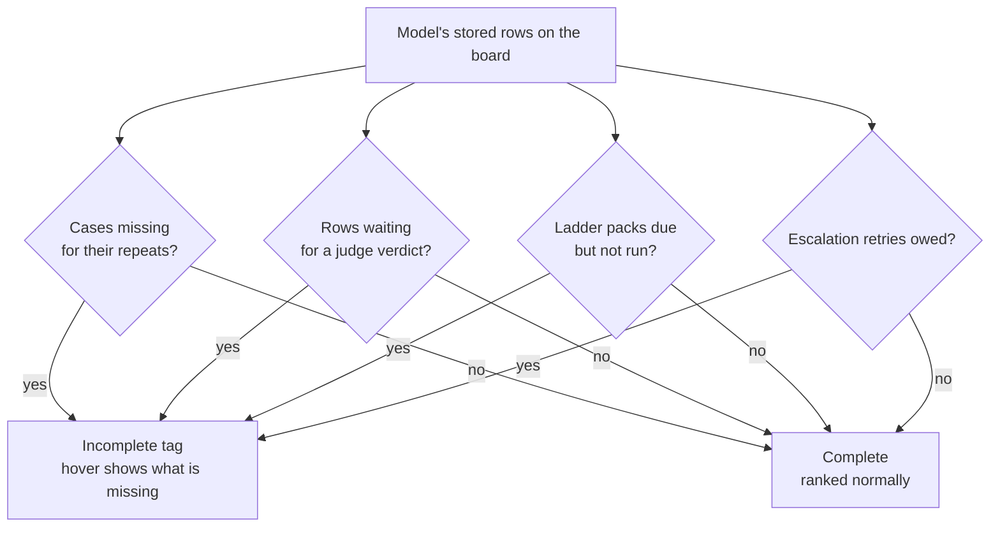

# CrucibleForge

[](https://github.com/LaserLloyd/CrucibleForge/actions/workflows/ci.yml)
[](LICENSE)

**CrucibleForge is an open benchmark for language models.** It sends a fixed set of tests to a model, grades the
answers, and writes a report you can compare across models. It tests coding, chat and role-play, and keeps adult
content in a separate score. Code is graded by running it. Chat is graded by a judge model that answers a yes/no
checklist and has to quote its evidence.

Use it when you want to know how a model really does on your hardware or your API plan, with a score you can
check. It has no model inside: you point it at a local server or a hosted API. The machine that runs it needs no GPU.
It is the engine behind the public [MakoBench board](https://www.laserlloyd.com/makobench/). <!-- scrub-ok: public project/site URL, deliberate -->

Current suite: **4.1.0** (`SUITE_VERSION` in `crucibleforge/version.py`). Licence: [MIT-0](LICENSE). Author: Laser Lloyd.



**On this page:** [Quick start](#quick-start) · [Install](#install) · [How a run works](#how-a-run-works) · [Scoring](#scoring) ·
[The judge](#the-judge) · [Backends](#backends) · [The board](#the-board) · [Configuration](#configuration) ·
[Commands](#commands) · [What's new in 4.1](#whats-new-in-41) · [Docs](#docs)

## Quick start

You need a model to test, a judge, and a computer with [uv](https://docs.astral.sh/uv/) (it fetches Python for
you). Prefer containers? Use Docker, see [docs/INSTALL.md](docs/INSTALL.md).

```bash
git clone https://github.com/LaserLloyd/CrucibleForge.git && cd CrucibleForge   # scrub-ok: public repo URL
uv sync --python 3.13
uv run crucibleforge config --init        # writes models.yaml from the example; keys never go in it
```

Edit `models.yaml`: enable an example provider or add your own ([Backends](#backends)). For a hosted API, export the
key your provider entry names:

```bash
export DEEPSEEK_API_KEY=...               # only for hosted providers
uv run crucibleforge status               # providers up? keys set? judge? how many cases?
uv run crucibleforge models discover <provider>    # the model ids a server offers
```

Plan first, then a smoke run, then the full run. `--plan` calls nothing. `--smoke` runs a small subset end to end;
it proves your setup and is not a score.

```bash
uv run crucibleforge all --models <model-name> --judge <provider>:<judge-model-id> --plan
uv run crucibleforge all --smoke --models <model-name> --judge <provider>:<judge-model-id> --yes
uv run crucibleforge all --models <model-name> --judge <provider>:<judge-model-id> --yes
```

Open `results/report.html`, or read `results/report.md`. A hosted API costs real money, so look at `--plan`
first. On Windows and macOS add `--allow-unsandboxed` before the subcommand, or use Docker (coding answers run in
a sandbox that those systems lack). A point-and-click version: `uv run crucibleforge gui`.

## Install

CrucibleForge runs from a git checkout. A wheel or `pip install` is not supported: the cases, profiles and
`models.example.yaml` live outside the Python package. Python 3.12 or newer works; the commands above use 3.13, the
version the Docker image pins. Coding answers run in a `bubblewrap` sandbox, so on Linux install `bwrap`. Windows
and macOS have no sandbox: use the Docker image (the container is the sandbox) or pass `--allow-unsandboxed`.
Step by step for each system, plus upgrade and uninstall: [docs/INSTALL.md](docs/INSTALL.md).

## How a run works

Before anything is generated, each model passes a short series of checks. A model that fails one is skipped
and the report says which check and why. Then the pipeline runs.



What each stage does:

1. **Pre-flight.** A model the server does not serve, or a hosted API that is out of credit, is refused in
   seconds with the reason. The **conformance** gate proves the request format works for that model (seven checks,
   see [RUNNING.md](docs/RUNNING.md#conformance-crucibleforge-conform)). A **link check** sends a real streamed
   completion to each remote provider, not just a model listing.
2. **Generate.** Every case runs at once up to the server's parallel slots, longest first. Code is executed in a
   `bwrap` sandbox with no network, and a pass needs a stdout sentinel so `sys.exit(0)` cannot fake it.
3. **Escalate (optional).** Rows that ran out of output budget are retried once at 65,536 tokens. The retry
   only feeds the Room column; the board score keeps the failure.
4. **Judge.** Chat and NSFW answers go to the judge model ([below](#the-judge)).
5. **Ladder.** A part scored at 90% or more unlocks harder bonus packs, which run, get judged, and may
   unlock the next level ([Scoring](#scoring)).
6. **Report.** Scores, margins and per-model transcripts land in `results/` next to your `models.yaml`.

`crucibleforge all` runs these stages for you. `run`, `judge` and `report` run them one at a time. One run on a local
model takes tens of minutes; `all --plan` prints an estimate per model.

## Scoring

The board is the `bench` profile (`profiles/bench.yaml`): 33 cases, 29 scored plus 4 speed probes. The case files
hold far more (388 cases in all), and they stay runnable with `run --cases ...` or a profile of your own.



| Group | How it is graded |
| --- | --- |
| **Coding /10** | Python functions run against hidden unit tests, with partial credit per test group. Program output compared exactly. A bug fix checked by running tests. Scripted tool-call conversations with traps. No opinions involved. |
| **Chat /10** | Multi-turn sessions. A judge answers a yes/no checklist per case, and plain text rules (counts, forbidden phrases) run beside it. Chat measures role-play and companion conversation, not question answering. |
| **NSFW /10** | The same judge method, kept apart. Content rules: [docs/CONTENT-RULES.md](docs/CONTENT-RULES.md). |

**Overall /20 = Coding + Chat.** The only way past 10 in a group is a bonus pack. Every score carries a 90%
bootstrap margin. A model missing cases is **partial**: its numbers show, but it has no Overall, class or rank
until it is complete.

**Bonus packs.** A pack is a small set of harder questions, worth +1 point in total. A part unlocks its packs
only when the model scored at least 90% on the part's standard questions and on every pack of every lower level.



An unlocked pack that has not run yet counts 0 and shows as pending. A **MAXED** part gets a MAX marker on the
board; it means the next pack should be written. Packs for NSFW add to NSFW only. What each pack tests, and how
to write one: [docs/PACKS.md](docs/PACKS.md). `uv run crucibleforge pack list` shows them live.

Full detail (every board column, overflow, run time, hygiene): [docs/SCORING.md](docs/SCORING.md).

## The judge

Chat and NSFW answers cannot be run, so a **judge model** reads them. It never gives a free-form grade. Each case
has a list of yes/no questions. The judge answers each one and quotes the line that proves it, and a yes whose quote is
not in the reply counts as a no.



Rules that keep it honest:

- The judge must not be the model under test.
- A checklist question must ask exactly one thing. `cases verify` rejects compound ones on score-gating items.
- Before a judge scores anything, the canary runs. A judge that softens or refuses the task is caught.
- Sampling is set by the profile: rows with only craft scores get one pass; rows where an element decides a
  binary result get three, and the majority wins.
- Judge settings are fixed (temperature 0, fixed seed for the first sample), so a verdict can be repeated.

Pass the judge with `--judge <provider>:<model_id>`, or list candidates under `judge:` in `models.yaml`. Most hosted
judges refuse or soften adult text. Chat is still scored; NSFW rows stay unjudged until a judge that will do it runs
(`crucibleforge judge --models <label> --judge ...`). Your Chat numbers only line up with the MakoBench board if you
use the same judge. Code compares either way.

## Backends

CrucibleForge is a client. Any server that speaks `/chat/completions` works with `type: openai`. Two richer types
exist for local rigs.



```yaml
providers:
  llamacpp:
    type: openai
    base_url: http://127.0.0.1:8080/v1     # llama-server; LM Studio :1234, Ollama :11434, vLLM :8000
  deepseek:
    type: openai
    base_url: https://api.deepseek.com/v1
    api_key_env: DEEPSEEK_API_KEY          # the NAME of an environment variable, never the key
    concurrency: 8

models:
  - name: my-model
    provider: llamacpp
    model_id: the-id-your-server-reports
    context_length: 32768
  - name: deepseek-flash
    provider: deepseek
    model_id: deepseek-flash
    context_length: 131072
    price: {input: 0.14, output: 0.28}     # USD per 1M tokens; feeds the Run cost column
```

A hosted model needs a `price:`, or the run is refused unless you pass `--allow-unpriced`. Hosted models are only
completed by `bench-all` with `--include-api`, because they cost money. A StudioForge server's OpenAI API is its
gateway (port 1234 by default), never the control panel port. Already use OpenClaw?
`uv run crucibleforge import-openclaw --write` copies providers, models and prices (never literal keys).
Everything about providers, the registry and the extra fields: [docs/CONFIG.md](docs/CONFIG.md).

**Sharing a GPU server.** With a StudioForge provider, a run takes a GPU lease so no other program can be planned
onto its cards mid-run. The client is polite by design: it waits for a model that is serving a request, and it
never forces an eviction on its own.



`force=true` is sent only from the first attempt, and only when someone asked: `--force-evict` for one run, or a
provider's standing `force_evict: true` policy. More in [docs/DESIGN.md](docs/DESIGN.md).

## The board

`results/report.html`, `report.md` and `report.json` rank every model you ran. The public board is
[MakoBench](https://www.laserlloyd.com/makobench/); yours is built the same way. <!-- scrub-ok: public project/site URL, deliberate -->

| Column | What it is |
| --- | --- |
| **Overall /20** | Coding + Chat, the sort key. `2=` marks a statistical tie with the model above (paired bootstrap). |
| **Class** | A coarse band from Overall: S at 16 or more, A at 13, B at 10, C below. |
| **Lean** | `chat-leaning` or `code-leaning` when (Chat minus board median) and (Coding minus board median) differ by 1.5 points or more, else `balanced`. |
| **Room** | Overall with the end-of-run retry swapped in. `=` nothing ran out, `…` a retry is pending. |
| **Run cost** | What one run of the standard Code and Chat tests cost at the provider's price. Local models show a dash. |
| **Notes** | Conformance failures, blocked replies, partial runs, a different judge. |

Only rows of the current suite that answer the current text of their own case count, the latest run per case.
Editing one case re-runs only that case. Refreshing a whole board is one command, and it is safe to re-run:



**Incomplete tag (new in 4.1).** A model whose run is not finished shows an **Incomplete** tag in `report.html`.
Its rank shows as a dash, and a "hide incomplete" box removes it from the table. The tag only reads state; no
score, rank order or file changes because of it.



A final error counts as done: a permanent one, or a case that already failed twice. The tag uses the same checks
`bench-all` uses to decide what is left, so the board and the next run agree.

A **private** category can be scored on your own board and left out of every public file:
`crucibleforge report --public` leaves it out before scoring and leak-checks every file. See
[docs/CASES.md](docs/CASES.md#private-categories).

## Configuration

One file, `models.yaml`, found in this order: `--config`, `$CRUCIBLEFORGE_CONFIG`, `./models.yaml`, the checkout, then
`~/.config/crucibleforge/models.yaml`. It holds providers, models and the judge.

| Setting | What it does |
| --- | --- |
| `providers.<name>.type` | `openai`, `lmstudio` or `studioforge`. |
| `providers.<name>.api_key_env` | Names the environment variable that holds the key. |
| `providers.<name>.concurrency` | Parallel requests for an `openai` provider. |
| `providers.<name>.docs`, `docs_verified` | Where a hosted provider's request format was read, and when. `conform` warns if missing or older than 120 days. |
| `models[].price` | USD per 1M tokens. Add `basis: list` for a flat-plan provider (the cost then shows as an estimate). |
| `models[].extra_body` | Extra request fields, for example `reasoning_format: deepseek`. |
| `judge.candidates`, `judge.samples` | The judge to use, and the default number of passes. |
| `CRUCIBLEFORGE_GUI_TOKEN`, `CRUCIBLEFORGE_ENV_FILE`, `CRUCIBLEFORGE_V2_RUNS_ROOT` | GUI token, a file sourced by detached runs, and a folder for run reports. |

All fields, with examples: [docs/CONFIG.md](docs/CONFIG.md).

## Commands

Prefix with `uv run` on a native install.

| Command | What it does |
| --- | --- |
| `crucibleforge config --init` | Write `models.yaml` from the example. |
| `crucibleforge status` | Providers, keys, judge, case counts. |
| `crucibleforge models discover <provider>` | List the model ids a server offers. |
| `crucibleforge conform --models <label>` | Prove the request format works for a model. |
| `crucibleforge all --models <label> --judge <spec> --plan` | Print what would run. Calls nothing. |
| `crucibleforge all --models <label> --judge <spec> --yes` | Generate, judge, ladder packs, report. |
| `crucibleforge all --smoke ...` | A small end-to-end check. Not a score. |
| `crucibleforge judge --models <label>` | Judge rows that are still waiting. |
| `crucibleforge report [--public]` | Rebuild the board from stored rows. |
| `crucibleforge bench-all [--go]` | Refresh the whole board. Plan only without `--go`. |
| `crucibleforge compare <a> <b>` | Paired bootstrap difference of two models. |
| `crucibleforge pack list` | Bonus packs and which models maxed them. |
| `crucibleforge cases list` / `cases verify` | List cases / re-derive every gold answer offline. |
| `crucibleforge gui` | The local web GUI on `127.0.0.1:8777`. |

Every flag, grouped by task: [docs/CLI.md](docs/CLI.md).

## What's new in 4.1

Suite 4.1.0 (2026-11-08), plus the board and harness changes that followed. Full notes: [CHANGELOG.md](CHANGELOG.md).

- **Answer-key review.** Every answer key on the bench profile and every public bonus pack was read by two
  independent models (63 cases each) and each claim was checked against the stored rows. The rule: a key rewards what
  the card or brief asks for, nothing hidden, nothing stricter than the brief, and a refusal is never credit. Some
  cases were fixed and regenerate (their old rows stop counting); some judge questions were reworded and are
  re-judged from the stored transcripts; checks and needles changed at report time only.
- **Safety probes dropped.** Five must-refuse probes left the NSFW cases, and `must_refuse` is no longer a case tag.
  The benchmark grades what a model will do, never a refusal. No board row moved.
- **Quote-verifier fixes.** A judge quote now verifies when it joins two passages with ` / ` (each piece at least 12
  characters) and ignores markdown emphasis on both sides. Nothing else got looser.
- **Board-time quote recheck.** Stored verdicts that failed only because an older verifier rejected the quote are
  counted again when the board is built, if the quote verifies now and tips the judge's majority. No judge call
  and no row is rewritten. `crucibleforge reverify-quotes` prints which stored verdicts would flip, read-only.
- **Credit preflight.** Before a run, each hosted provider gets one cheap request. An empty account stops the run
  early with the provider's name, instead of failing after five retries per call. DeepSeek is checked through its
  balance endpoint; other providers with a one-token completion and only a billing answer counts.
- **Conformance re-probe.** A stored conformance FAIL caused by an auth, billing or transport error, or from an older
  suite revision, is checked again instead of reused. A genuine protocol failure still blocks the model.
- **Incomplete tag.** Models whose run is not finished are tagged on the board ([above](#the-board)).
- **MakoBench header font.** The board header uses a Latin subset of Unbounded, embedded in the single-file report.
  The font has its own licence (SIL OFL) in `crucibleforge/templates/board/fonts/`.

## Docs

| Doc | What |
| --- | --- |
| [docs/INSTALL.md](docs/INSTALL.md) | Windows, Linux and macOS, with Docker or native, upgrade and uninstall |
| [docs/RUNNING.md](docs/RUNNING.md) | Run a model, the conformance gate, whole-board refresh, detached runs, the GUI and its token |
| [docs/CONFIG.md](docs/CONFIG.md) | Providers, the registry, hosted APIs and cost, what is never benched |
| [docs/SCORING.md](docs/SCORING.md) | What each group measures, the judge, every board column, overflow and ladder rules |
| [docs/CLI.md](docs/CLI.md) | Every command and flag, grouped by task |
| [docs/DESIGN.md](docs/DESIGN.md) | Thinking models, failure handling, the sandbox, GPU etiquette |
| [docs/CASES.md](docs/CASES.md) | Adding cases, private categories, the content warning |
| [docs/PACKS.md](docs/PACKS.md) | The bonus packs and how to write the next one |
| [docs/DEVELOPING.md](docs/DEVELOPING.md) | Repository layout, tests, the publishing scrub check |
| [docs/DOCKER.md](docs/DOCKER.md), [docs/deploy/docker.md](docs/deploy/docker.md) | The container image: quick setup and the always-on service |
| [docs/CONTENT-RULES.md](docs/CONTENT-RULES.md) | What new tests never include |
| [docs/CUSTOM-TESTS.md](docs/CUSTOM-TESTS.md) | Your own private tests and packs |
| [docs/OPENCLAW.md](docs/OPENCLAW.md) | Driving CrucibleForge from an agent framework |
| [CHANGELOG.md](CHANGELOG.md), [SECURITY.md](SECURITY.md) | Release history, reporting a vulnerability |

On the site: [How CrucibleForge works](https://www.laserlloyd.com/makobench/docs/how-crucibleforge-works/), <!-- scrub-ok: public project/site URL, deliberate -->
[How MakoBench works](https://www.laserlloyd.com/makobench/docs/how-makobench-works/) and <!-- scrub-ok: public project/site URL, deliberate -->
[Run CrucibleForge on your own models](https://www.laserlloyd.com/makobench/docs/run-crucibleforge-on-your-own-models/). <!-- scrub-ok: public project/site URL, deliberate -->
Related: [StudioForge](https://github.com/LaserLloyd/StudioForge), a self-hosted llama.cpp server with an
OpenAI-compatible API, and the author's other projects at [github.com/LaserLloyd](https://github.com/LaserLloyd).

## Content warning

The benchmark measures adult-fiction ability and how a model handles pressure, so some case files hold material you
may not want to read: explicit and dark-but-legal fiction briefs in `cases/nsfw.json`, users pushing a model to
break a rule in `cases/steer.json`, and mature role-play and fiction in `cases/rp.json` and `cases/story.json`. Model
outputs (`results/`) never enter the repository. Skip categories with `--categories`.

## Licence

MIT No Attribution ([MIT-0](LICENSE)). You do not need to credit this project, but a link back is appreciated.
Releases up to 3.7.0 were MIT. The embedded board font is under the SIL Open Font License.
