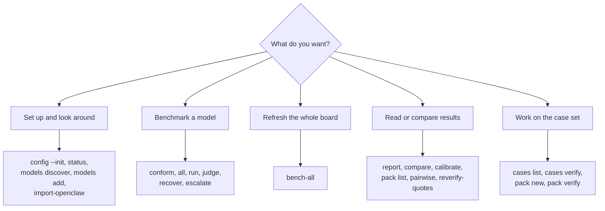

# Command line reference

[README](../README.md) · [Install](INSTALL.md) · [Running](RUNNING.md) · [Config](CONFIG.md) · [Scoring](SCORING.md) · [CLI](CLI.md) · [Design notes](DESIGN.md) · [Cases](CASES.md) · [Developing](DEVELOPING.md)

Every command below exists in 4.1.0. `uv run crucibleforge <command> --help` is the full, current list of
flags. From a native install put `uv run` in front; with Docker use
`docker compose -f deploy/compose/compose.yml run --rm app <command>`.

Two flags go **before** the subcommand and apply to everything:

| Flag | What it does |
| --- | --- |
| `--config PATH` | Use this `models.yaml` instead of the default search (see [CONFIG.md](CONFIG.md)). |
| `--results DIR` | Write results here (default: `results/` next to `models.yaml`). |
| `--allow-unsandboxed` | Run model-written code with no isolation. Needed on Windows and macOS, or on Linux without `bubblewrap`. |

## Which command do I want?

## Set up

| Command | What it does |
| --- | --- |
| `config --init [PATH]` | Write `models.example.yaml` to `./models.yaml` (or `PATH`). |
| `config --upgrade` | Rewrite an old v2 registry in the current providers shape. |
| `config` | Print where `models.yaml` was found. |
| `status` | Providers up or down, keys set, the judge, case counts. On StudioForge it also shows residents and leases. |
| `models discover <provider>` | List the model ids a provider serves. |
| `models add <name> <provider> <model_id>` | Add a model to the registry. Optional `--context-length`, `--price-in`, `--price-out` (USD per 1M tokens), `--tags`. |
| `import-openclaw [--write]` | Copy providers, models and prices from an OpenClaw `openclaw.json`. `--openclaw-json PATH`, `--include-local`. See [OPENCLAW.md](OPENCLAW.md). |

## Benchmark

| Command | What it does |
| --- | --- |
| `conform --models <label>` | Prove the request protocol works for a model: seven checks. `--json`, `--allow-load`, `--profile`. |
| `all --models <label> --judge <provider>:<id> --yes` | The normal path: generate, judge, ladder packs, report. |
| `all ... --plan` | Print what would run per model. Calls no model, no provider and no judge. |
| `all ... --smoke` | A small subset end to end. Proves the setup; it is not a score. |
| `run` | Generate answers only (no judge, no report). |
| `judge --models <label>` | Judge rows that are waiting for a verdict. `--force` re-judges everything, `--retry-failed` only failed verdicts, `--cases` limits it to some case ids. |
| `recover --models a,b --yes` | Re-run reasoning-overflow rows (empty answers) through the recovery path. |
| `escalate --models a,b --yes` | Re-run rows that ran out of budget at the profile's escalation rungs (64k for the bench profile). Feeds the Room column only. |
| `pairwise --models a,b --categories rp,nsfw --yes` | Position-swapped head-to-head A/B Elo on creative categories. |

Flags shared by `run` and `all`:

| Flag | Meaning |
| --- | --- |
| `--models a,b` or `all` | Model labels from `models.yaml`; `all` means every enabled one. |
| `--judge SPEC` | `provider:model_id`, a registry label, or a name under `judge.candidates`. |
| `--judge-fallback` | With `--judge`: allow the next candidate if the forced judge cannot load. Default is strict. |
| `--samples N` | Judge passes per row (default from `models.yaml`; the bench profile lowers it for some rows). |
| `--cases ids`, `--categories list`, `--difficulty easy,medium,hard` | Narrow what runs. |
| `--fresh` | Archive the model's earlier transcript first. |
| `--skip-conformance` | Do not gate on a conformance record. The override is logged. |
| `--no-link-check` | Skip the pre-flight data-channel probe. |
| `--allow-unpriced` | Run a hosted model that has no `price:` (its Run cost stays blank). |
| `--force-evict` | StudioForge only: send `force=true` on the first lease attempt. Use it only with the rig owner's go-ahead. |
| `--yes` | Proceed even if LM Studio is serving another model. |
| `--detach`, `--run-id`, `--deliver-to`, `--requester`, `--task-run-id` | Run as a transient `systemd --user` unit and write a run report for an agent framework. See [OPENCLAW.md](OPENCLAW.md). |

Extra flags on `all`: `--plan`, `--escalate`, `--no-escalate`, `--no-ladder` (or `--no-tiers`), `--timing`, `--force`.

## Refresh the whole board

| Command | What it does |
| --- | --- |
| `bench-all` | Print the plan. Touches nothing. |
| `bench-all --go` | Do it. Add `--detach` on a server. |
| `bench-all --only a,b` | Touch only these labels. |
| `bench-all --include-api` | Also complete hosted-API models (metered, costs money). |
| `bench-all --until HH:MM` | Everything done by that time. `--plan-start HH:MM` and `--judge-reserve-min N` tune the estimate. |
| `bench-all --plan-json` | The plan as one JSON object. |
| `bench-all --no-judge`, `--no-ladder`, `--escalate`, `--no-prune`, `--no-sync`, `--register-new`, `--first labels`, `--lease-mode night\|day`, `--quant-reason REASON` | See `bench-all --help`. |

Exit codes: 0 done, 1 a model failed (the others are still judged), 2 `--only` names nothing, 3 the public board refused a
leak, 4 the server is busy, 5 the server is unreachable.

## Read and compare

| Command | What it does |
| --- | --- |
| `report` | Rebuild the board from stored rows and print the scorecard. |
| `report --public [--out DIR]` | Build the public board: private categories left out, every file leak-checked. |
| `compare <a> <b>` | Paired bootstrap difference of two models' headline scores. Calls no model. |
| `calibrate [--reference <label>]` | Flag sub-scores the reference model aces (too easy) and sub-scores a model maxed (needs a new pack). Reads the board only. |
| `pack list [--json] [--no-board] [--recompute]` | Every pack per part, its questions, planner time estimate, and the models that maxed the part. |
| `reverify-quotes [--json]` | Read-only: which stored judge verdicts the current quote verifier would flip to PASS. |

## Work on the cases

| Command | What it does |
| --- | --- |
| `cases list [--categories list] [--difficulty tiers] [-v]` | List cases; the last line is the count. |
| `cases verify` | Re-derive every gold answer offline: run each reference solution in the sandbox, check every mutant fails, recompute math and reasoning answers. |
| `pack new <category/part> [--count N] [--level N] [--grading exact\|python_exec\|judged]` | Scaffold the next pack for a part, for example `work/code`. |
| `pack verify <file>` | Check one pack file. |

## GUI

| Command | What it does |
| --- | --- |
| `gui [--host H] [--port P] [--token T] [--no-open]` | The local web GUI. Default `127.0.0.1:8777`. |
| `gui token show` | Print the token the GUI would use and where it comes from. |
| `gui token rotate [--token-stdin]` | Write a new token to the data directory. |

Token rules and lockout recovery are in [RUNNING.md](RUNNING.md#accounts-and-lockout-recovery).
