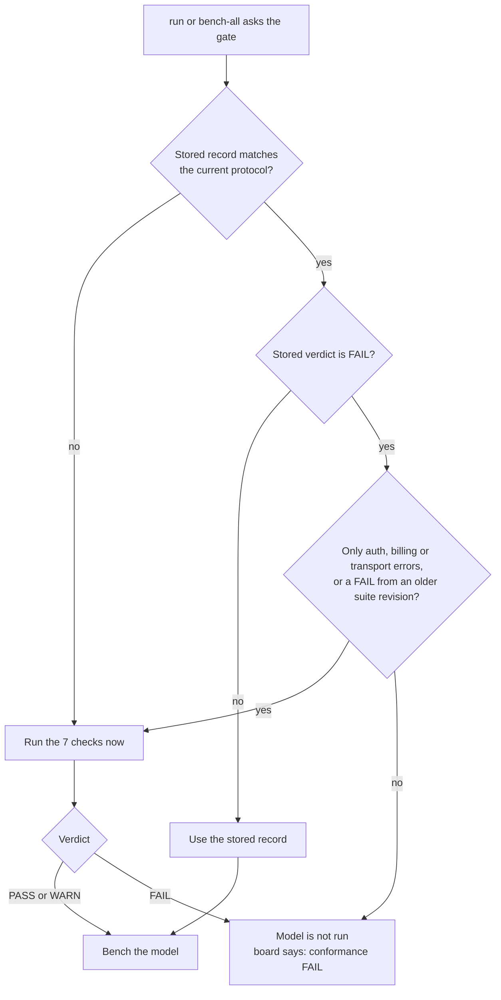
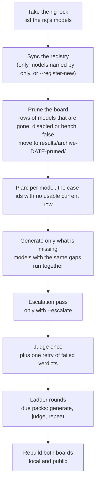

# Running benchmarks

[README](../README.md) · [Install](INSTALL.md) · [Running](RUNNING.md) · [Config](CONFIG.md) · [Scoring](SCORING.md) · [CLI](CLI.md) · [Design notes](DESIGN.md) · [Cases](CASES.md) · [Developing](DEVELOPING.md)

This page covers one model, the whole board, detached runs, the conformance gate, and the web GUI.

## Run the 4.5 standard test

The default profile is `bench45`, composition `standard`. A bare `crucibleforge all` runs it; the 4.1 test is
`--profile bench` ([archive](SCORING.md#the-41-archive)). From a native install prefix `uv run`; with Docker use
`docker compose -f deploy/compose/compose.yml run --rm app <args>`. On Windows and macOS add `--allow-unsandboxed`
before the subcommand.

```bash
uv run crucibleforge status                          # providers up? keys? judge? case counts
uv run crucibleforge all --models <label> --judge <provider>:<judge-model-id> --plan   # estimate, calls nothing
uv run crucibleforge all --smoke --models <label> --judge <provider>:<judge-model-id> --yes   # setup check, not a score
uv run crucibleforge all --models <label> --judge <provider>:<judge-model-id> --yes    # the standard run
uv run crucibleforge report                          # rebuild the board from stored rows
```

`all` = `run` then `judge` then ladder packs then `report` (`escalate` only with `--escalate`).

- **NSFW+ by default.** NSFW+ (NSFW+ /20 = NSFW /10 + Uncensored /10, beside Overall and never part of it) runs in every standard run. It is left out
  only with `--no-nsfw-plus` (on `run`, `all`, `recover`, `escalate` and `bench-all`) or with `nsfw_plus: false` on a
  model entry (the older `adult_page` key is still read). The Claude
  Code route never runs it. `all --plan` says `NSFW+: not run (--no-nsfw-plus)` and lists no NSFW+ unit when it is left
  out. NSFW+ sends explicit and dark fiction requests to the model and the run's local judge classes the answers; a hosted
  model that you do not want that on needs `--no-nsfw-plus`.
- **One local judge.** The judge grades the long chat scenes and the role-play sessions and classes NSFW+, all
  inside `judge` / `all`. It must be served locally: a hosted model given as `--judge` is refused when the
  judge step starts. `all --plan` does not check this yet and `all` generates before it judges, so check the
  judge you name before a paid run.
  There is no second reader.
- **Packs.** A part that scores 90% unlocks its harder sets in the same run. `--no-ladder` (or `--no-tiers`)
  runs the standard questions only; `--ladder-sections work` limits packs to one section.
- **Time.** Every job runs at once up to the server's parallel slots, longest first. The plan prints an
  estimate (not a measurement) of generation and judge minutes. Measured: about $0.35 and 20 minutes of generation for one flash-class model, about $1.50 and 50 to 60 minutes for another; the local judge and pack pass then took 40 to 90 minutes on the judge's GPUs; three full runs of a local 27B thinking model, judge and packs included, took 269, 314 and 432 minutes with 8 parallel slots on two GPUs; a single-GPU run was not measured.

### How a run works

`crucibleforge all` runs these stages for you; `run`, `judge` and `report` run them one at a time.

1. **Pre-flight.** A model the server does not serve, or a hosted API that is out of credit, is refused in seconds
   with the reason, and the report says which check failed. The conformance gate proves the request format works
   for that model ([below](#conformance-crucibleforge-conform)). A link check sends a real streamed completion to
   each remote provider, not just a model listing.
2. **Generate.** Every case runs at once up to the server's parallel slots, longest first. Code is executed in a
   `bwrap` sandbox with no network, and a pass needs a stdout sentinel so `sys.exit(0)` cannot fake it.
3. **Escalate (optional, `--escalate`).** Rows that ran out of output budget are retried once at 65,536 tokens. The
   retry only feeds the Room column; the board score keeps the failure.
4. **Judge.** The judged parts go to the local judge model.
5. **Ladder.** A part scored at 90% or more unlocks harder bonus packs, which run, get judged, and may unlock the
   next level. `--no-ladder` skips them.
6. **Report.** Scores, ranges and per-model transcripts land in `results/` next to your `models.yaml`.

### Spend cap and the plan price

For a hosted model, `all --plan` prints `~$X expected` and `$Y if every row ran to its budget` (packs and the
judge are extra: size the cap for the whole run). There are two caps and one rule for each, the same in `run`,
`all`, `agree` and the judge passes. `--spend-cap-usd USD` caps **this invocation's own spend** and never reads
the shared ledger (`agree --cap-usd` is the same rule). `CF_SPEND_CAP_USD` together with a ledger
(`CF_SPEND_LEDGER`; the fixed bench45 ledger under that profile) is a **cumulative budget across invocations**
(`CF_SPEND_CAP_MODEL` limits it to one model). Both may apply; whichever is reached first stops the call. Every
invocation books its spend into the ledger either way. The plan line shows both figures, for example
`this run: up to $0.80; budget: $4.12 spent of $10.00`. Once a cap is spent or reserved, further hosted calls
are refused and the run stops with a message. The
`bench45` profile also carries a standing ceiling (`spend.global_cap_usd`; override `CF_SPEND_GLOBAL_CAP_USD`).
A hosted model needs a `price:` in `models.yaml` (a real run without one is refused, naming the missing price;
`--allow-unpriced` waives it only when no cap is set), and a hosted **judge** must have a price too, or the run
is refused before generation. `crucibleforge spend status` prints the ledger.

### Output budgets

Every row is sent with a fixed output budget, the same for every model (a model's own lower cap is a separate case):

<!-- budgets:begin -->
| Part | Output tokens one reply may use (the budget sent) |
| --- | --- |
| Careful small functions | 65,535 per prompt of three briefs |
| Follows tool rules | 16,384 per reply on two dialogues, 65,536 on the third |
| Steps through code | 71,680, 70,656 or 69,632 by difficulty level (4, 6, 8) |
| Knows language traps | 65,536 |
| Uses tools | 16,384 per turn on the seeded tool tasks, with up to 49,000 tokens of history room |
| State over a session | 16,384 per turn |
| Keeps a tally over a session | 16,384 per turn, with up to 49,000 tokens of history room |
| Says what it does not know | 71,680 |
| Role-play: sessions | 16,384 per turn, with up to 49,000 tokens of history room |
| Role-play: long scenes | 16,384 per turn |
<!-- budgets:end -->

A reply that ends on the length limit having used at least 98% of the budget sent for its row "did not finish"; on the short-keyed parts and on NSFW+ it is graded as delivered and counted, and on the one-shot fix and change tasks of Fixes it scores 0 (see `docs/SCORING.md`).

### Judge requirements

The role-play parts need a judge: `--judge <provider>:<model_id>`, a registry label, or a name under `judge:` in
`models.yaml`. The 4.5 profile's judge is the plain Qwen 3.8 27B at 8-bit with a 16,384-token context: about
29 GB of weights (27 billion parameters at 8.5 bits each), plus the context cache. It is also the board's reference
model: when it is under test it grades its own rows and the board says "graded by itself" (a same-family judge is
noted too). The 4.1 profile keeps its Gemma 4 31B judge, which never grades the model under test or its family.
Before scoring, a canary of known answers runs; a judge that fails it
twice aborts the phase and nothing is scored. A different judge works for the long scenes but is flagged on the
board. The ladder pass also accepts a different judge for the role-play sessions. Its verdicts, rung check and
placements are keyed and stamped with that judge's own id, and a session the profile's judge already placed is
left alone. The board prints the part as "(judged by <id>, not the board's judge: not comparable)". That row is never
ranked against rows placed by the profile's judge, and `report --public` refuses to publish it. `--no-judge` leaves the
judged parts pending (Overall blank, row unranked); `crucibleforge judge --models <label>` judges them later.
`all` places the role-play sessions of the models it ran on their ladders (the `ladder-judge` pass) right after the
standard judge, so the one documented command is complete; `--no-judge` skips it. To place stored sessions by hand (or
again), run `crucibleforge ladder-judge --models <label>` (`--plan` first).

### Results directory

`results/` sits next to `models.yaml` (or wherever `--results` points, before the subcommand):

| File | What it is |
| --- | --- |
| `transcripts_<label>.jsonl` | Every request and reply, with reasoning, metrics, stamps and judge verdicts (append-only) |
| `meta_<label>.json` | Run settings, timing per phase, early-stop record, version stamps |
| `MANIFEST-<label>.json`, `.md` | What the run covers |
| `report.md`, `report.html`, `report.json`, `failures.md` | The board, rebuilt by `report` |
| `runs.csv` | One line per generated job |
| `conformance/<label>.json` | The request-protocol check ([below](#conformance-crucibleforge-conform)) |
| `rpladder/` | Cached ladder-judge verdicts |
| `archive-<date>-…/` | What `--fresh` or `bench-all` moved aside |

### Resume

Nothing needs a special command: run the same command again. Finished jobs are reused (per case and repeat the
newest *finished* run counts, so an aborted resume never replaces a finished one); errored or missing jobs are
re-run; judged rows keep their verdicts. `--fresh` archives the model's earlier transcript first. A drain
request (SIGUSR1 or a `<results>/.drain` file) lets in-flight requests finish, then exits with code 75 so a later
run resumes. A row whose stamp no longer matches is **stale**: `report --check-stale` lists them (exit 1); re-run
or regrade them, they are not mixed silently.

### From a finished run to a board

`scripts/release45.py` takes a set of finished run folders (one folder = one run of one model; repeat runs of a
model are separate folders) to a rendered board. It prints its plan first, then runs the steps in order, and can be
run as a systemd user unit (no TTY, no prompt):

    uv run python scripts/release45.py --folders <run1> <run2> ... [--board <dir>] [--dry-run] \
        [--only <step or letter>] [--force <step,step>] [--report-jobs N] [--reference <label>]

The default steps, in order:

| Step | What it does |
| --- | --- |
| b-judge | `crucibleforge judge` with the profile's local judge on each folder: rows not judged yet and the NSFW+ classing |
| c-assemble | Combine the folders into the board dir (rows, the judge's NSFW+ votes and agreeing mark blocks) |
| d-report | `crucibleforge report` for each folder alone; `--report-jobs N` renders N folders at once (default 3) |
| e-resolution | `resolution45.py`: the run-to-run spread on the board's own scale, read from each folder's `report.json`, into `precision45.json` |
| e-board | `crucibleforge report` for the combined board, which reads `precision45.json` |
| e-accuracy | `accuracy45.py`: each model's range per score; prints, never withholds |

A model with several folders shows the mean of its runs on the board, and its ranges come from the run-to-run spread
([SCORING.md](SCORING.md#margins-and-ties)). The other steps (the generating steps a-fix and a-everyday, the marks
steps c-*, and the second-reader steps b-c1, b-c6, b-classing, b-chat, b-packs kept from earlier builds) run only
when `--only` names them in full; no hosted reader is ever picked.

Each finished step writes `<folder>/.release45/<step>.json` (the tree's commit and the step's inputs) and is skipped on
the next run while both are current; `--force a,b` re-runs the named steps anyway (an unknown name stops with exit 2).
`--only` runs one step or one letter. Before and after each generating step every stored row line is hashed and must
still be there (exit 4 otherwise). The run refuses to start while the file named by `CF_MAINTENANCE_MARKER` exists
(exit 5). Everything is logged to `<folder>/release45.log`. Exit codes: 0 done, 2 input missing, 3 a step failed, 4 a
stored row changed, 5 maintenance marker, 6 a generated unit is still missing, 7 a sanity entry not accepted.

#### Environment for a release run

Set `CRUCIBLEFORGE_CONFIG=<the models yaml the runs used>` and export the environment the runs used (the local judge's
server key, if it has one). The driver checks this before it starts and stops with exit 2 and one line when
`CRUCIBLEFORGE_CONFIG` is unset, or when a selected step would call a hosted model under test (the generating steps)
whose key is missing; it never prints a key. The default steps call no hosted model. `--dry-run` skips the check.

### Operator notes

`CF_MAINTENANCE_MARKER=<path>` (optional): when that file exists, `ladder-judge` and `agree` print
"maintenance marker present: nothing done" and exit 3 without calling anything, so a host that is being backed up or
restarted is left alone. Unset (the default) means no check.

`CRUCIBLEFORGE_PRIVATE_FROM=<checkout>` (launch renders): `report --public` checks its output against the private
category names, case ids and labels. A checkout or worktree that has no `cases/private` knows none, so it would
skip the check; point this variable at the checkout that holds the private files (read in place, never copied)
and the check runs. When no list is configured the render prints "private-term check SKIPPED, no list is
configured". A checkout named here that yields no terms is refused.

`crucibleforge registry-check [--lab DIR] [--profile bench45]` checks that every scored part and every bonus set in
the profile names an item in the lab registry (a folder of `items/<NAME>.json`), with the same pack, section and
points. The lab folder is `--lab`, else `$CF_LAB_DIR`, else `~/.local/share/crucibleforge/lab`. It fails closed: a
missing folder, a missing item or any disagreement is an error. It is a maintainer's check; a plain run never needs it.

### Troubleshooting

| You see | Do this |
| --- | --- |
| `config error: no models.yaml found` | `uv run crucibleforge config --init` |
| A hosted run refused: missing price | Add `price:` to the model entry (and to a hosted judge) |
| `spend cap reached` | Raise `--spend-cap-usd`, or stop; finished jobs are kept and reused |
| `not ranked: stale …` | The rows predate the current grader stamps: re-run, or `report --check-stale` to see which |
| A thinking model's parts read `not measured (n of m replies cut)` | Its replies hit the ceiling; the same budget applies to everyone. Not a bug. (On the short-keyed parts a reply that used the full budget is instead counted as "did not finish" and graded as delivered.) |
| Server busy / lease refused (StudioForge) | A 503 `priority_hold` means wait and retry; a 409 is terminal. Never force on someone else's server |
| Coding rows error on Windows or macOS | No sandbox there: Docker, or `--allow-unsandboxed` before the subcommand |
| Judge phase aborted at the canary | The judge softens or refuses; use another judge. Nothing was scored |


## Conformance (`crucibleforge conform`)


How the gate decides, for each model, before anything is generated:



A model is benched with ONE request protocol, and the protocol differs per
provider: MiniMax requires its reasoning chain to be sent back (the chain
dropped measured 1/10 recall against 7/10 replayed), a hosted API may ignore
`temperature`, a model id can be retired while `/v1/models` still lists it.
`conform` proves the protocol per model with a handful of cheap calls that go
through the bench's OWN request path, the same `Provider.chat` and the same
message builders the run uses, so a PASS means the bench itself would talk
to the model correctly:

| check | what it proves |
| --- | --- |
| `c1 served` | a 1-turn call succeeds; the model the API reports is recorded (alias detection); a 4xx is a FAIL |
| `c2 reasoning` | where the reasoning arrives (`reasoning_content`, inline `<think>`, none) and that no think tags leak into the answer |
| `c3 chain` | a 2-turn memory probe whose fact lives only in the reasoning, with the current reasoning-replay setting and with the opposite one: the opposite recalling better means the replay setting is wrong for this model |
| `c4 tools` | a 2-step tool round trip (call → tool result → answer); a 4xx or a malformed history is a FAIL |
| `c5 sampler` | the sampler the profile would send for this model is accepted |
| `c6 budget` | a medium coding prompt at the board budget; an empty answer with `finish=length` needs the escalation rung (see Room) |
| `c7 docs` | the vendor docs of a **hosted** provider: the registry row says where the protocol was read (`docs`) and when it was last checked (`docs_verified`); a missing entry, or one older than 120 days, is a WARN |

The record lands in `results/conformance/<label>.json` with the protocol
fingerprint (provider type, reasoning replay, extra_body keys, sampler), so a
harness change can tell which rows are stale. A rig model (StudioForge / LM
Studio) is only checked while it is loaded: `conform` never loads a model
behind the bench's back (`--allow-load` does, under the rig lock).

## The gate (`run` / `bench-all`)

A model is benched only under a request protocol that has been **proven** for
it. `run` and `bench-all` require a conformance record for the *current*
fingerprint: when it is missing or stale the checks run first (a rig model
right after it is loaded, an API model before the run). A **FAIL** means the
model is **not run**: the run summary and the board say which check failed.
`--skip-conformance` overrides the gate; the override is logged.

Every row now carries the protocol it was measured under (`protocol` in the
transcript), so a harness change can tell which rows are stale: a model whose
rows mix fingerprints gets the note *"rows predate harness change … 
re-run"* on the board. `report.md` has a **Conformance** section with each
model's verdict and the date it was proven on; the board's Notes column says
`conformance FAIL: <check>` (or a WARN summary).

## Refreshing the whole board


What `bench-all` does when you add `--go` (without it, it prints the plan and touches nothing):



With `--until HH:MM` every phase has to finish by that time: a model starts only when its estimated generation
plus judge time fits, and the judge stops before the end. Unjudged rows wait for the next run.

To ask a running `run`, `all`, `recover`, `escalate` or `bench-all` to **drain** (the requests in flight finish, nothing new is sent,
then the process exits with no judge or board, exit code 75, and a later run resumes), send it `SIGUSR1`
(`kill -USR1 <pid>`, `systemctl --user kill -s USR1 <unit>`) or create `<results>/.drain`. Nothing is cut unless you set a
ceiling: `--drain-max-minutes N` (or a number in the file, or `$CRUCIBLEFORGE_DRAIN_MAX_MINUTES`); a stream cut by it leaves no
row, and the notes then say to unload and reload the model before the next run.

```bash
uv run crucibleforge bench-all            # the plan: what is missing, what would change
uv run crucibleforge bench-all --go       # do it (add --detach on a server)
```

`bench-all` lists the models your StudioForge server has, registers a chat
model the registry lacks **only when `--only` names it** (or with
`--register-new` for every in-scope one; out-of-scope kinds and the judge are
never registered; appended as text so `models.yaml` keeps its comments), moves
board rows of models that are gone, disabled, unregistered or `bench: false`
to `results/archive-<date>-pruned/`, generates
only the case ids each model is missing (never `--fresh`), judges once, and
rebuilds both boards. Re-running it is always safe; with everything complete
it reports *nothing to do*. Exit codes: 0 done · 1 a model failed (the others
are still judged and on the board) · 3 the public board refused a leak · 4 the
server is busy (judge lease refused) · 5 the server is unreachable. Hosted-API
models are completed only with `--include-api` (they cost money).

## Detached runs and the run report

`--detach` (on `run`, `all`, `judge` and `bench-all`) re-launches the command as
a transient `systemd --user` unit and returns at once. Two optional settings,
both off by default:

- `CRUCIBLEFORGE_ENV_FILE`: a file the detached unit sources before it starts
  (for example one holding `STUDIOFORGE_MCP_PIN=…`), so a secret never appears
  in the unit's command line.
- `CRUCIBLEFORGE_V2_RUNS_ROOT`: a directory that receives a
  `<run id>/{meta.json,report.md}` run report (status `running`, then
  `done`/`failed`) for a scanner that delivers finished runs. Unset, no run
  report is written.

To set them once for every invocation on a machine (cron units, scripts, a
terminal), put `KEY=VALUE` lines in a git-ignored `crucibleforge.local.env`
next to `models.yaml`. Only `CRUCIBLEFORGE_*` keys are read from it, and a
variable already in the environment wins.

## GUI

`crucibleforge gui [--host 127.0.0.1] [--port 8777] [--token …]`

Loopback needs no token unless one is configured (`--token`, `CRUCIBLEFORGE_GUI_TOKEN` or a stored `gui_token`). Binding another host (e.g. to reach it over a
VPN) **requires** a token: one is generated and printed if you don't
pass one; open the printed URL once and a cookie carries it. State-changing
calls are same-origin only. The GUI runs the same code paths as the CLI (a
run is a background thread; **Stop** finishes the in-flight case).

`crucibleforge gui token show|rotate` manage a stored token (`<data dir>/gui_token`); a `RESET_LOGIN` file recovers a lost one 
see [Accounts and lockout recovery](RUNNING.md#accounts-and-lockout-recovery).

## Accounts and lockout recovery

CrucibleForge has **no user accounts and no password database**. Its one login is the **GUI access token**: required when the GUI is
reachable from another machine, optional on `127.0.0.1`. Provider API keys are not stored by the app at all (`api_key_env` in
`models.yaml` names an environment variable), so there is nothing to reset for them. The CLI itself has no login.

**Where the token lives.** In the *data directory*, the folder that holds `models.yaml` and `results/`, as `gui_token` (one line, mode 0600 on Linux/macOS; on Windows it inherits the folder's permissions, so keep the data dir in your own profile or lock it down).
`crucibleforge config` prints the path of `models.yaml`; its folder is the data dir. Every `gui token` command prints the data dir it acts on.

| Install | Data dir |
|---|---|
| Native, from a clone | the checkout (`./models.yaml`), or `~/.config/crucibleforge/` (`%USERPROFILE%\.config\crucibleforge` on Windows; `$XDG_CONFIG_HOME` is honoured) |
| Docker Compose | `/data` inside the container: the named volume `crucibleforge-data` (host path: `docker volume inspect crucibleforge_crucibleforge-data`), or your `DATA_PATH` bind mount. On Docker Desktop (Windows, macOS) a named volume lives inside the VM, so use the `exec` commands below rather than the host path |

The GUI picks its token in this order: `--token`, then `CRUCIBLEFORGE_GUI_TOKEN`, then `gui_token`; off-loopback with none of those it
prints a fresh random one on every start. A token must be 12-256 characters of `A-Z a-z 0-9 . _ ~ -`.

**Show, rotate or set the token** (run from the clone for native installs; if you keep `models.yaml` elsewhere put `--config <path>` *before* `gui`, e.g. `uv run crucibleforge --config <path> gui token show`):

```bash
uv run crucibleforge gui token show                       # prints the token and where it comes from
uv run crucibleforge gui token rotate                     # new random token -> <data dir>/gui_token
printf '%s\n' 'a-token-you-chose-123' | uv run crucibleforge gui token rotate --token-stdin   # Linux / macOS
docker compose -f deploy/compose/compose.yml exec app crucibleforge gui token show           # Docker
docker compose -f deploy/compose/compose.yml exec app crucibleforge gui token rotate         # Docker
```

```powershell
uv run crucibleforge gui token show                       # Windows (PowerShell)
uv run crucibleforge gui token rotate
'a-token-you-chose-123' | uv run crucibleforge gui token rotate --token-stdin
'a-token-you-chose-123' | docker compose -f deploy/compose/compose.yml exec -T app crucibleforge gui token rotate --token-stdin   # Docker
```

A running GUI keeps the token it started with: **restart it** (`docker compose -f deploy/compose/compose.yml restart app`, or stop and
start `crucibleforge gui`) and the old token stops working. A stored token also applies on `127.0.0.1`, so rotating once turns the token on
there too. If `CRUCIBLEFORGE_GUI_TOKEN` is set (Docker: `deploy/compose/.env`) it wins over the file; change or remove it there instead.

**Locked out, with filesystem access only** (the token is lost and you cannot run a command): create a file named `RESET_LOGIN` in the data
dir and start (or restart) the GUI. At start-up, before the port is opened, CrucibleForge deletes the file, writes a new token to
`gui_token` and logs one line (`login reset from RESET_LOGIN: ...`, never the token). An empty file means "make a random token"; a file
containing text uses that text as the token. A file it cannot use or cannot delete is removed or ignored with a logged reason, never
acted on twice. Then read the token with `gui token show` (a stored token is never written to the log).

```bash
cd <data dir> && : > RESET_LOGIN                                   # Linux / macOS (random token)
printf '%s\n' 'a-token-you-chose-123' > RESET_LOGIN                # Linux / macOS (chosen token)
docker compose -f deploy/compose/compose.yml exec app sh -c ': > /data/RESET_LOGIN'    # Docker
docker compose -f deploy/compose/compose.yml restart app
docker compose -f deploy/compose/compose.yml exec app crucibleforge gui token show
```

```powershell
cd <data dir>; New-Item RESET_LOGIN -ItemType File                  # Windows (random token)
Set-Content -NoNewline RESET_LOGIN 'a-token-you-chose-123'         # Windows (chosen token)
```

Only `gui_token` is changed. `models.yaml`, `results/`, the case files and every provider setting are kept. The sentinel is read by the
`crucibleforge gui` start-up code only; no HTTP request can create, read or trigger it (`tests/test_accounts_20261019.py` pins this), so
a reset needs the ability to write into the data dir, which is the same access as reading the token file.
