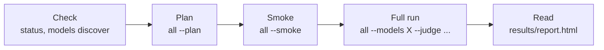
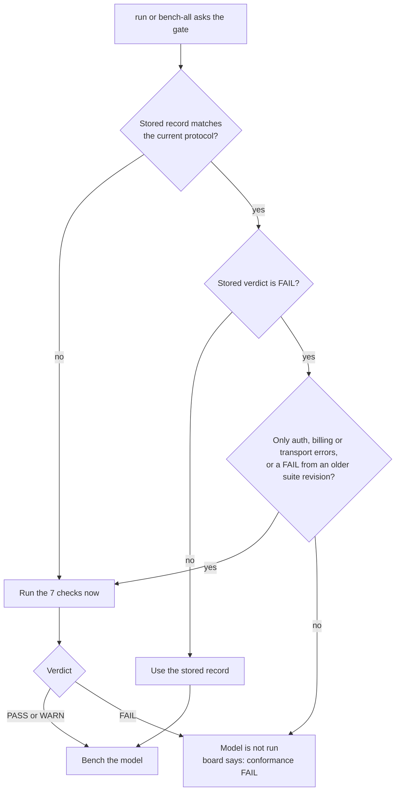
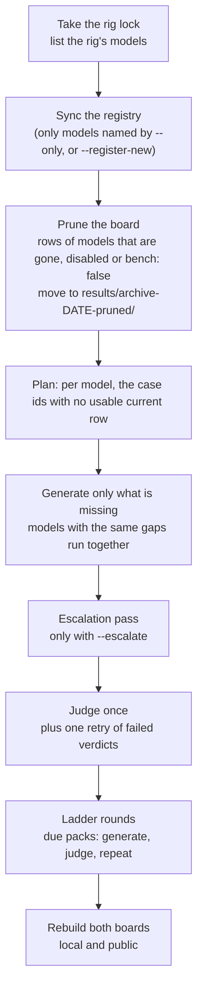

# Running benchmarks

[README](../README.md) · [Install](INSTALL.md) · [Running](RUNNING.md) · [Config](CONFIG.md) · [Scoring](SCORING.md) · [CLI](CLI.md) · [Design notes](DESIGN.md) · [Cases](CASES.md) · [Developing](DEVELOPING.md)

This page covers one model, the whole board, detached runs, the conformance gate, and the web GUI.
For the commands in one table see [CLI.md](CLI.md). For how scores are made see [SCORING.md](SCORING.md).



## Run a benchmark

From a native install, prefix `uv run`; with Docker use `docker compose -f deploy/compose/compose.yml run --rm app <args>`. Add `--allow-unsandboxed`
before the subcommand on Windows and macOS.

```bash
uv run crucibleforge status                   # providers up? judge? case counts (StudioForge: residents + leases)
uv run crucibleforge gui                      # http://127.0.0.1:8777
export DEEPSEEK_API_KEY=...                   # only if you use a hosted provider
uv run crucibleforge all --models local-gemma-e4b --fresh --yes   # the board: Coding + Chat + NSFW
uv run crucibleforge all --smoke --models local-gemma-e4b --yes   # smoke-tagged subset, end-to-end
uv run crucibleforge report                   # rebuild the board (prints the scorecard)
uv run crucibleforge recover --models a,b --yes     # re-run reasoning-overflow rows, then judge again
uv run crucibleforge pairwise --models a,b --categories rp,nsfw --yes  # position-swapped head-to-head
uv run crucibleforge models discover <provider>     # list what a server is serving
uv run crucibleforge cases verify                   # re-derive every gold answer offline
uv run crucibleforge conform --models <label>       # prove the request protocol works for a model
```

`crucibleforge all` = `run` → (`escalate`, only with `--escalate`) → `judge` → ladder packs → `report`. Results land in
`results/` next to your `models.yaml`: `report.md` (the scorecard),
`failures.md`, `report.html`, `report.json`, append-only `runs.csv`, and
per-model `transcripts_<label>.jsonl` (every prompt, response, reasoning,
metric and judge verdict). `--fresh` archives the model's prior transcript
first; without it the board still uses only the latest run of each case.
Only one benchmark runs at a time: `run`/`all`/`judge`/`recover` take
`results/.rig.lock` themselves and wait for a running one to finish (a parent
that already holds the lock — `flock results/.rig.lock …` — is recognised).

## Conformance (`crucibleforge conform`)


How the gate decides, for each model, before anything is generated:



A model is benched with ONE request protocol, and the protocol differs per
provider: MiniMax requires its reasoning chain to be sent back (the chain
dropped measured 1/10 recall against 7/10 replayed), a hosted API may ignore
`temperature`, a model id can be retired while `/v1/models` still lists it.
`conform` proves the protocol per model with a handful of cheap calls that go
through the bench's OWN request path — the same `Provider.chat` and the same
message builders the run uses — so a PASS means the bench itself would talk
to the model correctly:

| check | what it proves |
| --- | --- |
| `c1 served` | a 1-turn call succeeds; the model the API reports is recorded (alias detection); a 4xx is a FAIL |
| `c2 reasoning` | where the reasoning arrives (`reasoning_content`, inline `<think>`, none) and that no think tags leak into the answer |
| `c3 chain` | a 2-turn memory probe whose fact lives only in the reasoning, with the current reasoning-replay setting and with the opposite one — the opposite recalling better means the replay setting is wrong for this model |
| `c4 tools` | a 2-step tool round trip (call → tool result → answer); a 4xx or a malformed history is a FAIL |
| `c5 sampler` | the sampler the profile would send for this model is accepted |
| `c6 budget` | a medium coding prompt at the board budget; an empty answer with `finish=length` needs the escalation rung (see Room) |
| `c7 docs` | the vendor docs of a **hosted** provider: the registry row says where the protocol was read (`docs`) and when it was last checked (`docs_verified`); a missing entry, or one older than 120 days, is a WARN |

The record lands in `results/conformance/<label>.json` with the protocol
fingerprint (provider type, reasoning replay, extra_body keys, sampler), so a
harness change can tell which rows are stale. A rig model (StudioForge / LM
Studio) is only checked while it is loaded — `conform` never loads a model
behind the bench's back (`--allow-load` does, under the rig lock).

## The gate (`run` / `bench-all`)

A model is benched only under a request protocol that has been **proven** for
it. `run` and `bench-all` require a conformance record for the *current*
fingerprint: when it is missing or stale the checks run first (a rig model
right after it is loaded, an API model before the run). A **FAIL** means the
model is **not run** — the run summary and the board say which check failed.
`--skip-conformance` overrides the gate; the override is logged.

Every row now carries the protocol it was measured under (`protocol` in the
transcript), so a harness change can tell which rows are stale: a model whose
rows mix fingerprints gets the note *"rows predate harness change … —
re-run"* on the board. `report.md` has a **Conformance** section with each
model's verdict and the date it was proven on; the board's Notes column says
`conformance FAIL: <check>` (or a WARN summary).

## Refreshing the whole board


What `bench-all` does when you add `--go` (without it, it prints the plan and touches nothing):



With `--until HH:MM` every phase has to finish by that time: a model starts only when its estimated generation
plus judge time fits, and the judge stops before the end. Unjudged rows wait for the next run.

```bash
uv run crucibleforge bench-all            # the plan: what is missing, what would change
uv run crucibleforge bench-all --go       # do it (add --detach on a server)
```

`bench-all` lists the models your StudioForge server has, registers a chat
model the registry lacks **only when `--only` names it** (or with
`--register-new` for every in-scope one; out-of-scope kinds and the judge are
never registered; appended as text so `models.yaml` keeps its comments), moves
board rows of models that are gone, disabled, unregistered or `bench: false`
to `results/archive-<date>-pruned/`, generates
only the case ids each model is missing (never `--fresh`), judges once, and
rebuilds both boards. Re-running it is always safe; with everything complete
it reports *nothing to do*. Exit codes: 0 done · 1 a model failed (the others
are still judged and on the board) · 3 the public board refused a leak · 4 the
server is busy (judge lease refused) · 5 the server is unreachable. Hosted-API
models are completed only with `--include-api` (they cost money).

## Detached runs and the run report

`--detach` (on `run`, `all`, `judge` and `bench-all`) re-launches the command as
a transient `systemd --user` unit and returns at once. Two optional settings,
both off by default:

- `CRUCIBLEFORGE_ENV_FILE` — a file the detached unit sources before it starts
  (for example one holding `STUDIOFORGE_MCP_PIN=…`), so a secret never appears
  in the unit's command line.
- `CRUCIBLEFORGE_V2_RUNS_ROOT` — a directory that receives a
  `<run id>/{meta.json,report.md}` run report (status `running`, then
  `done`/`failed`) for a scanner that delivers finished runs. Unset, no run
  report is written.

To set them once for every invocation on a machine (cron units, scripts, a
terminal), put `KEY=VALUE` lines in a git-ignored `crucibleforge.local.env`
next to `models.yaml`. Only `CRUCIBLEFORGE_*` keys are read from it, and a
variable already in the environment wins.

## GUI

`crucibleforge gui [--host 127.0.0.1] [--port 8777] [--token …]`

Loopback needs no token unless one is configured (`--token`, `CRUCIBLEFORGE_GUI_TOKEN` or a stored `gui_token`). Binding another host (e.g. to reach it over a
VPN) **requires** a token — one is generated and printed if you don't
pass one; open the printed URL once and a cookie carries it. State-changing
calls are same-origin only. The GUI runs the same code paths as the CLI (a
run is a background thread; **Stop** finishes the in-flight case).

`crucibleforge gui token show|rotate` manage a stored token (`<data dir>/gui_token`); a `RESET_LOGIN` file recovers a lost one —
see [Accounts and lockout recovery](RUNNING.md#accounts-and-lockout-recovery).

## Accounts and lockout recovery

CrucibleForge has **no user accounts and no password database**. Its one login is the **GUI access token**: required when the GUI is
reachable from another machine, optional on `127.0.0.1`. Provider API keys are not stored by the app at all (`api_key_env` in
`models.yaml` names an environment variable), so there is nothing to reset for them. The CLI itself has no login.

**Where the token lives.** In the *data directory*, the folder that holds `models.yaml` and `results/`, as `gui_token` (one line, mode 0600 on Linux/macOS; on Windows it inherits the folder's permissions, so keep the data dir in your own profile or lock it down).
`crucibleforge config` prints the path of `models.yaml`; its folder is the data dir. Every `gui token` command prints the data dir it acts on.

| Install | Data dir |
|---|---|
| Native, from a clone | the checkout (`./models.yaml`), or `~/.config/crucibleforge/` (`%USERPROFILE%\.config\crucibleforge` on Windows; `$XDG_CONFIG_HOME` is honoured) |
| Docker Compose | `/data` inside the container: the named volume `crucibleforge-data` (host path: `docker volume inspect crucibleforge_crucibleforge-data`), or your `DATA_PATH` bind mount. On Docker Desktop (Windows, macOS) a named volume lives inside the VM, so use the `exec` commands below rather than the host path |

The GUI picks its token in this order: `--token`, then `CRUCIBLEFORGE_GUI_TOKEN`, then `gui_token`; off-loopback with none of those it
prints a fresh random one on every start. A token must be 12-256 characters of `A-Z a-z 0-9 . _ ~ -`.

**Show, rotate or set the token** (run from the clone for native installs; if you keep `models.yaml` elsewhere put `--config <path>` *before* `gui`, e.g. `uv run crucibleforge --config <path> gui token show`):

```bash
uv run crucibleforge gui token show                       # prints the token and where it comes from
uv run crucibleforge gui token rotate                     # new random token -> <data dir>/gui_token
printf '%s\n' 'a-token-you-chose-123' | uv run crucibleforge gui token rotate --token-stdin   # Linux / macOS
docker compose -f deploy/compose/compose.yml exec app crucibleforge gui token show           # Docker
docker compose -f deploy/compose/compose.yml exec app crucibleforge gui token rotate         # Docker
```

```powershell
uv run crucibleforge gui token show                       # Windows (PowerShell)
uv run crucibleforge gui token rotate
'a-token-you-chose-123' | uv run crucibleforge gui token rotate --token-stdin
'a-token-you-chose-123' | docker compose -f deploy/compose/compose.yml exec -T app crucibleforge gui token rotate --token-stdin   # Docker
```

A running GUI keeps the token it started with: **restart it** (`docker compose -f deploy/compose/compose.yml restart app`, or stop and
start `crucibleforge gui`) and the old token stops working. A stored token also applies on `127.0.0.1`, so rotating once turns the token on
there too. If `CRUCIBLEFORGE_GUI_TOKEN` is set (Docker: `deploy/compose/.env`) it wins over the file; change or remove it there instead.

**Locked out, with filesystem access only** (the token is lost and you cannot run a command): create a file named `RESET_LOGIN` in the data
dir and start (or restart) the GUI. At start-up, before the port is opened, CrucibleForge deletes the file, writes a new token to
`gui_token` and logs one line (`login reset from RESET_LOGIN: ...`, never the token). An empty file means "make a random token"; a file
containing text uses that text as the token. A file it cannot use or cannot delete is removed or ignored with a logged reason, never
acted on twice. Then read the token with `gui token show` (a stored token is never written to the log).

```bash
cd <data dir> && : > RESET_LOGIN                                   # Linux / macOS (random token)
printf '%s\n' 'a-token-you-chose-123' > RESET_LOGIN                # Linux / macOS (chosen token)
docker compose -f deploy/compose/compose.yml exec app sh -c ': > /data/RESET_LOGIN'    # Docker
docker compose -f deploy/compose/compose.yml restart app
docker compose -f deploy/compose/compose.yml exec app crucibleforge gui token show
```

```powershell
cd <data dir>; New-Item RESET_LOGIN -ItemType File                  # Windows (random token)
Set-Content -NoNewline RESET_LOGIN 'a-token-you-chose-123'         # Windows (chosen token)
```

Only `gui_token` is changed. `models.yaml`, `results/`, the case files and every provider setting are kept. The sentinel is read by the
`crucibleforge gui` start-up code only; no HTTP request can create, read or trigger it (`tests/test_accounts_20261019.py` pins this), so
a reset needs the ability to write into the data dir, which is the same access as reading the token file.
