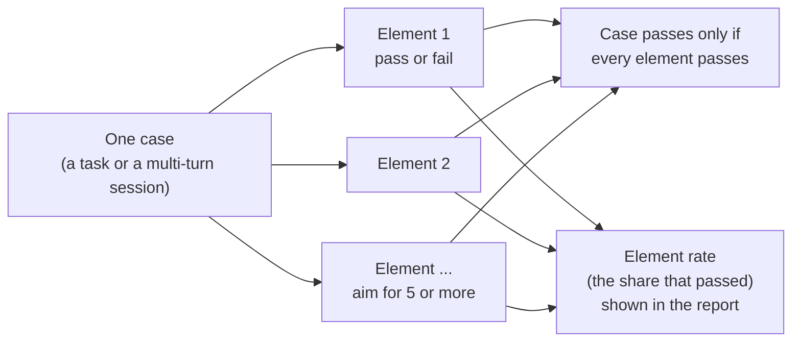

# Scoring and the judge

[README](../README.md) · [Install](INSTALL.md) · [Running](RUNNING.md) · [Config](CONFIG.md) · [Scoring](SCORING.md) · [CLI](CLI.md) · [Design notes](DESIGN.md) · [Cases](CASES.md) · [Developing](DEVELOPING.md)

The README has the short version with diagrams. This page keeps the full detail: what each group measures,
how the judge works, every board column, and the overflow, ladder and run-time rules.

## What the tests measure

The board is the `bench` profile (`profiles/bench.yaml`): 33 cases, 29 scored plus 4 speed probes. The case files
hold many more; they stay runnable with `run --cases ...` or a profile of your own.

| Group | Parts and points | How it is graded |
| --- | --- | --- |
| **Coding /10** | Functions 5, Predict and bug hunt 2.5, Tool use 2.5 | Python functions run against hidden unit tests (partial credit by test group); program output compared exactly; a bug fix checked by running tests; scripted tool-call conversations with traps. No opinions involved. |
| **Chat /10** | Deep role-play 3, Conversation 3, Character 2, Creative writing 2 | Multi-turn sessions. A judge model answers a yes/no checklist per case, and plain text rules (counts, forbidden phrases) run beside it. |
| **NSFW /10** | Uncensored 2, NSFW role-play 4, NSFW writing 4 | The same judge method. Shown beside the board and **never added to Overall**. Content rules: [`docs/CONTENT-RULES.md`](CONTENT-RULES.md). |

**Overall /20 = Coding + Chat.** A model that scores 90% or more on a part unlocks a harder bonus pack for it, the only way
past 10 (see *Ladder packs* below). Chat measures role-play and companion conversation, not plain question answering.

`crucibleforge cases verify` re-derives every gold answer offline, so the test set tests itself.

## What it measures

The board is `profiles/bench.yaml` (33 cases: 29 scored plus the 4 speed probes P1–P4): Coding (CL3–CL8 functions,
CB-C5/C6 predict-the-output, CB-F1 bug hunt, TZ16/TZ19/TZ20 tool use), Chat
(RD1, RD4, CC3, CC4, RV1, RV2, WR1, WR2 sessions) and NSFW (WL2, UX1, UX3,
NC1, NC2, NC3, NX2, XP3, NW1). The case files hold many more (math, reasoning,
long-context, instruct, harder coding); they stay runnable with
`run --cases …` or a profile of your own, and some of them are ladder packs.
Content rules: what new tests never include → [`docs/CONTENT-RULES.md`](CONTENT-RULES.md).

## The judge

Chat and NSFW answers cannot be run, so a **judge model** reads them. It never gives a free-form grade: each case has a list
of yes/no questions, the judge answers each one and quotes the line that proves it, and a yes whose quote is not in the reply
counts as a no. Rules that keep it honest:

- The judge must not be the model under test.
- A checklist question must ask exactly one thing (`cases verify` rejects compound ones on score-gating items).
- Before a judge scores anything, a calibration check (a good and a bad scene, an obvious refusal, an explicit scene it must
  score) runs. A judge that softens or refuses the task is caught and the batch aborts.
- Verdicts use fixed settings. `models.yaml` sets the default number of passes (3 in the example file); the bench profile lowers it to 1 for rows scored on craft dimensions alone and keeps 3 for rows where an element decides a binary result, with the majority winning.

The judge can be any capable instruct model, local or hosted: pass it with `--judge <provider>:<model_id>`, or list candidates
under `judge:` in `models.yaml`. Most hosted judges refuse or soften adult text. Chat is still scored; the NSFW rows then
stay "unjudged" until you judge them with a model that will do it (`crucibleforge judge --models <label> --judge ...`).
Your Chat numbers only line up with the MakoBench board if you use the same judge; Code compares either way.

### Elements

A case is not one big pass or fail. It is graded as several independent elements, and the report shows how many
passed. Details on writing elements are in [CASES.md](CASES.md#adding-cases).

## The board

The public board is [MakoBench](https://www.laserlloyd.com/makobench/). Your own board is the report CrucibleForge writes after a run. Both are built the same way. <!-- scrub-ok: public project/site URL, deliberate -->

`results/report.md` / `report.html` / `report.json` rank every model you ran:

| Column | What it is |
|---|---|
| **Overall /20** | Coding /10 + Chat /10. The sort key; `2=` marks a tie with the model above (paired bootstrap). |
| **Class** | a coarse capability band from Overall (`headline.classes` in `profiles/bench.yaml`: S ≥ 16, A ≥ 13, B ≥ 10, C below). |
| **Lean** | (Chat − board median) − (Coding − board median): `chat-leaning` / `code-leaning` at ≥ 1.5 points, else `balanced`. Complete models only. |
| **Room** | Overall with the end-of-run retry swapped in (see *Overflow*). `=` nothing ran out, `…` a retry is pending. |
| **Coding /10** | Functions 5 (six single-function Python tasks, partial credit = share of unit-test groups passed) + Predict & bug hunt 2.5 (predict a program's output; find and fix a bug in a small repo) + Tool use 2.5 (scripted tool-call conversations with traps). |
| **Chat /10** | Deep RP 3 + Conversation 3 + Character 2 + Creative writing 2 — multi-turn sessions with recall, retcons, card habits and stacked writing constraints. |
| **NSFW /10** | Uncensored 2 + NSFW RP 4 + NSFW writing 4. Shown beside the board, **never added to Overall**. |

± after a score is half the 90 % bootstrap interval. A model missing cases is
**partial**: its numbers are shown, but it has no Overall, Class or rank until
it is complete.

**Overflow.** Every row gets the same output budget (thinking models: up to
24,576 tokens). A row that runs out of it counts as failed on the board. With
`--escalate`, rows that ran out are retried **once**, at 65,536 tokens, in one
pass at the end of the run; the retry only feeds the Room column.

**Ladder packs (bonus points).** A sub-score at ≥ 90 % unlocks its harder
packs under `cases/ladder/<category>/<part>/set-<n>.json`: about three
questions worth 1 bonus point together, the only way past 10. `crucibleforge
pack new <category/part>` scaffolds one and `pack verify <file>` checks it;
a pack should add **at most ~5 minutes** of wall time on a local model
(`pack verify` warns when its estimate is over).

**Optional packs.** What each pack tests, the unlock rule, the MAXED marker and how to write
the next pack are in [`docs/PACKS.md`](PACKS.md). `uv run crucibleforge pack list`
prints every pack per part and which models have maxed it (`--json` for scripts).

**Run time.** Every job runs at once up to the server's parallel slots,
longest expected job first; a multi-turn session's turns are sequential, so
the longest session sets the floor. `crucibleforge all --plan` and `bench-all`
print an estimate per model (from the model's own earlier rows when it has
some). Every board case runs once (1 repeat).

**Board hygiene.** Only rows of the `bench` profile that answer the current
content of their own case count, latest run per (case, repeat), never more
repeats than the profile asks for. Editing one case re-runs only that case.

---
